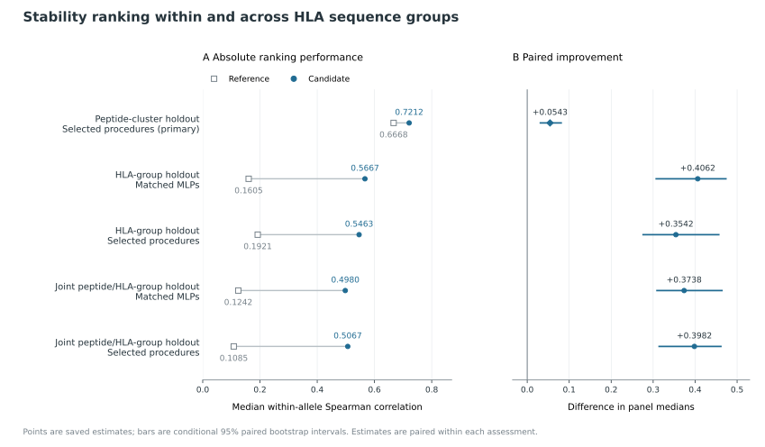
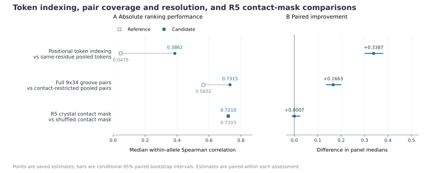
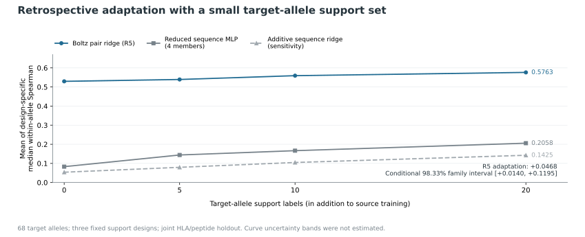

# Position-resolved Boltz-2 features improve peptide–HLA stability ranking

## Abstract

Whether internal features learned for structure prediction support peptide–HLA stability ranking depends on both representation choice and the evaluation setting. We evaluated frozen Boltz-2 features with supervised prediction heads to rank assay-derived complex stability in nested development assessments of 19,716 peptide–HLA pairs, using separate HLA-group and joint peptide/HLA holdouts. In the selector comparison, the prespecified embedding selector increased median within-allele Spearman correlation from 0.6668 to 0.7212 compared with a competitive sequence selector (difference +0.0543; conditional 95% interval [+0.0314, +0.0808]). In holdout comparisons with matched nonlinear heads, performance favored pair features under both the HLA-group holdout (0.5667 versus 0.1605) and the joint peptide/HLA holdout (0.4980 versus 0.1242). Token-pooling comparisons supported the utility of positional information, and the full pair interface outperformed contact-restricted pooling, though residue coverage and positional detail changed together; an advantage of the specified crystal-contact mask over shuffled membership remained unestablished. Separately, retrospective adaptation using 20 existing target-allele labels improved ranking correlation by +0.0468 (three-primary 98.33% interval [+0.0140, +0.1195]). All comparisons reuse a single assay corpus, and their intervals condition on saved predictions and selection decisions. Overall, these development comparisons support position-resolved pair features as inputs for supervised stability ranking, without establishing a physical mechanism, calibrated half-lives, or independent kinetic confirmation.

## Introduction

Peptide–human leukocyte antigen class I (pMHC-I) complex persistence shapes cell-surface antigen presentation, making complex stability a distinct predictive problem from equilibrium binding affinity. Experimental benchmarks quantify this persistence through scintillation-proximity dissociation assays ([Harndahl et al., 2011](https://pubmed.ncbi.nlm.nih.gov/21044632/)). Sequence-based neural networks already model these assay-derived stability measurements: NetMHCstab identified allele-dependent anchor submotifs associated with pMHC-I stability ([Jørgensen et al., 2014](https://pubmed.ncbi.nlm.nih.gov/23927693/)), and NetMHCstabpan extended this framework to pan-specific prediction using the assay collection analyzed here ([Rasmussen et al., 2016](https://pubmed.ncbi.nlm.nih.gov/27402703/)). Because established sequence predictors already capture strong anchor-position signals, testing whether structural representations improve stability ranking requires comparing them against sequence baselines trained within the same partitions.

Internal representations from frozen biomolecular structure predictors can be reused for supervised downstream learning without fine-tuning the structure model. AFToolkit demonstrated that AlphaFold-derived embeddings paired with simple adapters support protein-engineering tasks ([Sindeeva et al., 2025](https://pubmed.ncbi.nlm.nih.gov/40622483/)). Similarly, DeorphaNN integrated AlphaFold-predicted GPCR–peptide structures and embeddings for agonist screening, finding pair representations informative across retrospective transfer benchmarks and experimental validation ([Ferguson et al., 2026](https://pubmed.ncbi.nlm.nih.gov/42492505/)). Here, Boltz-2 supplies a frozen model for biomolecular structure and affinity prediction ([Passaro et al., 2025](https://doi.org/10.1101/2025.06.14.659707)), providing internal representations that can be probed for downstream stability prediction.

Applying this approach to pMHC-I stability raises two empirical questions: which feature granularity is useful for ranking assay-derived peptide–HLA persistence, and whether that utility holds when HLA groups and peptides are held out from supervised fitting. The short peptide and polymorphic binding groove make residue-position information a natural axis of comparison. We use Boltz-2 features as inputs to supervised stability predictors without interpreting the model's native affinity output as a kinetic estimate.

We evaluate these questions on existing pMHC-I dissociation data using frozen Boltz-2 feature caches and downstream predictors trained on stability labels. Our evaluation combines a prespecified main comparison against sequence baselines with dimension-matched positional and pooling controls that assess residue-position information across both peptide and HLA groove features. We pair these representational controls with supervised HLA-group and joint peptide–HLA holdouts, sequence–structure feature combinations, and label-budget and adaptation assessments. All analyses are retrospective development assessments on a shared benchmark rather than independent confirmation ([Cawley and Talbot, 2010](https://www.jmlr.org/papers/v11/cawley10a.html)). Together, these comparisons delineate when position-resolved structure features provide incremental ranking signal or complement sequence baselines across evaluation regimes.

## Results

### Interface features improve development ranking

We evaluated whether frozen Boltz-2 representations paired with ridge or multilayer perceptron (MLP) heads improve within-allele peptide–HLA stability ranking across 19,716 training pairs, 3,587 peptide clusters, and 69 eligible HLA-A/B alleles. Scores report median within-allele Spearman correlation, with conditional 95% intervals on the saved fitted predictions and selection decisions (Methods). In the prespecified primary contrast, the embedding-or-original selector achieved 0.7212 versus 0.6668 for the competitive sequence selector, yielding a paired gain of +0.0543 [0.0314, 0.0808] (Figure 1). This conditional interval excludes zero, supporting a positive ranking gain in the saved development comparison.

Inner folds selected complete procedures rather than a single global model, choosing the contact-pooled pair representation with an MLP head (R5 MLP) in four outer folds and the groove-averaged directed pair representation with ridge regression (R4 ridge) in one. An inner-selected blend of the original sequence ensemble with R4 ridge reached 0.7238 (+0.0569 [0.0426, 0.0838] over the sequence selector). The following representation, transfer, label-budget, and descriptor analyses are development follow-ups and do not replace the prespecified primary comparison.

**Figure 1 | Stability ranking within and across HLA sequence groups.** Panel A shows reference and candidate scores; panel B shows their paired differences. Rows compare reference and candidate procedures for the prespecified main contrast (diamond; competitive sequence selector versus embedding selector), matched transfer (R0 sequence MLP versus R5 pair-feature MLP) and selected transfer (expanded sequence selector versus embedding selector). Selected procedures use inner model selection, whereas matched MLPs share a common learner recipe but use different input representations. Each row compares procedures within its own assessment rather than across regimes. All rows use the development cohort's 69-allele panel (19,647 eligible rows). Bars indicate conditional 95% bootstrap intervals: whole peptide clusters for the main contrast and crossed peptide/HLA groups for transfer. [Exact values and source rows](manuscript/figure_data.csv).

### Token-position and pair-pooling comparisons across representation controls

To assess how positional indexing and spatial pooling affect ranking within specific feature families, we compared matched ablations (Figure 2). For projected residue-level features, preserving residue order (`R3_mlp`, 0.3862) outperformed mean-pooled tokens (`R3_pooled_mlp`, 0.0475) by +0.3387 [0.3029, 0.3773], demonstrating useful positional information relative to the matched pooled control. Nevertheless, the projected token model remained below the competitive sequence selector (0.6668).

Within the fixed projected pair interface, retaining the full 9×34 groove interface across all 34 groove residues achieved 0.7315 versus 0.5652 for a dimension-matched pooled-pair control that averaged only contact-mask-selected residues and tiled the pooled summary (+0.1663 [0.1378, 0.1992]); because residue coverage and positional resolution changed together, this contrast cannot isolate a positional effect. Retaining the full positional pair interface showed no established advantage over the compact R5 summary (+0.0106 [-0.0142, 0.0220]). Within R5, pooling over reference crystal-contact subsets (0.7210) versus a shuffled-contact control across the same 34 HLA positions (0.7203) likewise showed no established advantage under this recipe (+0.0007 [-0.0096, 0.0236]).

**Figure 2 | Positional resolution and contact-mask choice.** Reference and candidate procedures are matched within each row. The token comparison either preserves or pools residue positions under a fixed projection, whereas the pair-interface comparison contrasts all 34 groove positions with contact-restricted pooling while retaining peptide positions. Because the latter alters both residue coverage and positional detail, it does not isolate a groove-position effect. The contact-mask comparison varies HLA contact membership within the R5 construction. Absolute scores are shown alongside paired gains so that improvement over a weak control is not mistaken for performance above the sequence selector. Bars indicate pointwise conditional 95% peptide-cluster bootstrap intervals on the same 69-allele panel. The contact-mask interval spans zero, and equivalence is not established. [Exact values and source rows](manuscript/figure_data.csv).

### Pair representations transfer across held-out HLA groups and peptide clusters

Standard peptide-cluster splits share allele supervision between training and evaluation sets, whereas holding out entire HLA groups tests supervised readout transfer to alleles unseen during head fitting (Figure 1). Under HLA-group holdout, matched R5 MLP achieved 0.5667 versus 0.1605 for a matched sequence MLP (R0 MLP; +0.4062 [0.3073, 0.4733]), and the embedding selector exceeded the expanded sequence selector by +0.3542 [0.2762, 0.4563]. Under joint peptide-cluster and HLA-group holdout using crossed resampling, matched R5 MLP reached 0.4980 versus 0.1242 for matched R0 MLP (+0.3738 [0.3092, 0.4638]), while the embedding selector led the expanded sequence selector by +0.3982 [0.3143, 0.4613].

Although these nonlinear comparisons address the additive sequence-ridge limitation, they still evaluate complete predictive procedures that differ in inputs, feature dimensions, molecular context, and pretraining. Furthermore, excluding HLA groups from supervised fitting does not establish that related structures were absent from Boltz-2 pretraining. The expanded sequence selector was also not uniformly stronger than the original ensemble: under joint holdout, it scored 0.1085 versus 0.1350 for the original sequence reference.

### Label-budget robustness and target-allele adaptation

We next evaluated retrospective sensitivity to reduced training budgets across 25%, 50%, and 100% fitting-cluster fractions (including stopping labels) using separate fixed two-member MLP recipes for sequence and pair-interface inputs; this fixed sequence recipe is weaker than the main competitive sequence selector. Reducing fitting clusters from 100% to 25% lowered sequence scores from 0.5373 to 0.2640, whereas pair-interface scores declined from 0.6995 to 0.5877, widening the interface advantage at 25% by +0.1615 [0.1333, 0.2041] relative to 100%. This wider margin reflects retrospective robustness to fewer training clusters rather than prospective assay savings.

In a retrospective few-shot study across 68 alleles and three fixed support designs, we fitted target-specific residual adapters using 20 existing labels per allele (1,360 per design). Source predictors remained fixed and had been fitted without the target HLA group or the support/query peptide families (Figure 3). Adapting R5 ridge improved median correlation from 0.5296 (zero-shot) to 0.5763 at 20 labels (+0.0468 [0.0227, 0.1035]; three-primary family-adjusted 98.3333% interval [0.0140, 0.1195]), while a reduced four-member sequence reference (distinct from the competitive selector) rose from 0.0830 to 0.2058. Full adaptation outperformed an exploratory offset control specific to each allele and fitted joint cell (+0.0444 [0.0165, 0.0928]), whereas offset-only adjustment—which can alter rankings when predictions are pooled across cells even though each within-cell ordering is unchanged—showed no established improvement over zero-shot prediction (+0.0024 [-0.0062, 0.0239]).

**Figure 3 | Adaptation using existing target-allele labels.** Curves show the mean of design-specific median within-allele Spearman scores across three fixed support designs on 68 target alleles under joint HLA/peptide holdout. Source fitting excludes the target HLA group and support/query peptide families, and target labels fit residual adapters on fixed source predictors. The four-member sequence MLP serves as a reduced reference and sequence ridge as an additive sensitivity control; neither represents the main competitive sequence selector. Curve uncertainty bands were not estimated. The displayed interval for the 20-versus-zero-label R5 gain is conditional and adjusted to 98.33% for the three-primary follow-up family. [Exact curves, interval and source record](manuscript/figure3_data.json).

### Secondary descriptors and ranking heads show no established improvement

Finally, we tested whether external structural descriptors or alternative ranking heads improve predictions within the development cohort. On a balanced 4,449-pair panel with matched two-member heads, adding ProteinMPNN complex-context scores C to R5 plus peptide-only scores P (R5+P+C versus R5+P; +0.0240; family-adjusted 98.3333% interval [-0.0219, 0.0659]) or adding repaired FoldX terms E to R5 (R5+E versus R5; +0.0150; family-adjusted 98.3333% interval [-0.0524, 0.0450]) produced no established improvement within the same three-primary family as the adaptation test. Evaluating the selected R5+P+C specification against R5 alone across the full cohort as a secondary check likewise showed an uncertain difference (-0.0070; pointwise 95% interval [-0.0220, 0.0131]).

Alternative ranking objectives and selection rules also yielded uncertain differences. A pairwise RankNet loss (+0.0071 [-0.0051, 0.0098]) and a hybrid selector (+0.0044 [-0.0055, 0.0100]) each showed no established improvement in ranking accuracy. Although these non-significant differences do not establish equivalence or a universal failure of external descriptors, within our fitted procedures and assay cohort they show no established improvement from added descriptor or head complexity over simple regularized readouts of the frozen pair interface.

Historical benchmarks covering [earlier sequence and pretrained-feature comparisons](REPORT.md#earlier-sequence-and-pretrained-feature-comparisons) and [sequence-model ligand presentation](REPORT.md#sequence-predictions-transfer-to-ligand-presentation) are detailed in the supplement. Because those analyses use different evaluation populations, representations or biological endpoints, they neither provide a matched comparison with the internal pair-feature models nor offer independent kinetic-stability confirmation of the Boltz advantage.

## Discussion

Our results support a representation-dependent benefit of frozen Boltz-2 features for ranking assay-derived peptide–HLA stability. Position-resolved pair features improved ranking in the prespecified development comparison and retained useful performance when HLA sequence groups were excluded from supervised fitting. Paired estimates and conditional intervals supported positive differences across the saved assessments, though these findings remain qualified by conditional evaluation on a reused assay corpus rather than establishing independent generalization or biological usefulness.

Matched controls clarify this interpretation. Preserving positional resolution improved projected token features relative to their pooled control, yet the resulting token predictor still trailed the sequence selector, indicating that position preservation alone does not make every tested representation competitive. Similarly, the full pair interface outperformed its contact-restricted pooled control, although that comparison alters both groove-residue coverage and positional resolution. Separately, the designated crystal-contact mask showed no established benefit over shuffled membership within R5. Taken together, these computational controls do not isolate a unique physical mechanism, and comparisons across feature families also differ in channel projection, input context, and downstream capacity.

Previous work has applied AlphaFold-derived features to protein engineering (AFToolkit; [Sindeeva et al., 2025](https://pubmed.ncbi.nlm.nih.gov/40622483/)) and peptide–receptor agonist prediction (DeorphaNN; [Ferguson et al., 2026](https://pubmed.ncbi.nlm.nih.gov/42492505/)). Here, we assess representation choices for a peptide–HLA persistence endpoint using supervised group-transfer controls. The task dependence reported in recent work ([Chauhan, 2026, preprint](https://arxiv.org/abs/2606.04228)) is consistent with testing which representation suits a specific endpoint rather than assuming a universal structural advantage.

The transfer and label-limited analyses address distinct levels of information reuse. Excluding HLA groups removes supervised stability labels for related targets during downstream fitting, but it does not establish that related structures or sequences were absent from Boltz-2 pretraining; moreover, Boltz features still receive fuller molecular context than peptide/pseudosequence baselines. Likewise, although the label-budget and adaptation studies support retrospective robustness and target-specific refinement, their reduced sequence references cannot substitute for a matched comparison with the main competitive selector. Adaptation used twenty support labels in addition to source training, and these retrospective assessments do not quantify prospective assay savings.

Measurement characteristics and evaluation history further constrain interpretation. The supplied half-life summaries come from a single assay platform and a cohort selected partly through predicted binding, leaving generalization to an unselected peptide repertoire untested. Unresolved zero labels cannot distinguish low stability from failed complex formation or other measurement limits. Moreover, the models were assessed for ranking this recorded endpoint; calibration to physical half-lives or microscopic off-rates was not demonstrated. Earlier diagnostic test exposure and repeated use of the development cohort also limit claims of independent confirmation. Furthermore, the bootstrap intervals are conditional on saved predictions, selections, and support designs, leaving refitting, repeated search, and new assay variation outside their scope. A separate sequence-model ligand-elution result does not remove these kinetic-validation limits.

Within these boundaries, frozen position-resolved pair features provide useful inputs for supervised peptide–HLA stability ranking. The absence of established gains from added descriptors or more complex heads favors a parsimonious readout for the next fixed comparison, although potential gains remain uncertain under the tested settings because some descriptor intervals are wide enough to include worthwhile improvements. Independent kinetic measurements remain necessary to determine how far these development findings extend beyond the original assay population.

## Methods

### Measurements and assessment population

The source dataset comprises 28,166 peptide–HLA pairs across 5,633 nine-residue peptides and 75 HLA-A/B alleles or constructs, including three C67S constructs ([Rasmussen et al., 2016](https://pubmed.ncbi.nlm.nih.gov/27402703/)). Candidate peptides were selected partly by NetMHCpan 2.8 predicted affinity (<500 nM or top 2% rank), and the source modelling cohort retained molecules with at least one stable and two nonstable observations using a two-hour threshold. Consequently, the cohort is enriched for predicted binders rather than representing a random peptide repertoire.

Reported half-lives are geometric means from two independent experiments in a scintillation proximity assay tracking labelled β2-microglobulin dissociation as a proxy for complex persistence ([Harndahl et al., 2011](https://pubmed.ncbi.nlm.nih.gov/21044632/)). The supplied table lacks separate replicate observations, raw curves and measurement-level failure or censoring flags. Approximately 20% of the labels are zero, and rapid dissociation, failed complex formation and other measurement limits cannot be distinguished. We retained the recorded labels and used the natural-log transformation `log1p(thalf_hours)` as the regression target, whereas ranking procedures used their declared objectives.

We constructed a fixed study split containing 19,716 training, 2,817 validation, and 5,633 test rows. Peptides are grouped across alleles by single-linkage clustering at Hamming distance ≤3, with each connected component confined to a single partition. The main, transfer, label-budget, adaptation and descriptor assessments use the original training partition, which comprises 3,587 peptide clusters. An earlier diagnostic repartitioned the corpus, using 3,350 original test rows for fitting, 448 for stopping and 585 for scoring. Because those exposures and repeated use of the development cohort informed subsequent research choices, nested assessment does not restore independent confirmation. The [evaluation protocol](../EVALUATION.md) documents this history and all partition rules.

### Frozen representations and downstream predictors

Boltz-2 ([Passaro et al., 2025](https://doi.org/10.1101/2025.06.14.659707)) was used to process HLA ectodomain–β2-microglobulin–peptide inputs for the 19,716 training rows via `boltz==2.1.1`, where the package version differs from the Boltz-2 model family. From each input, we extracted frozen final-trunk single-token (`s`) and directed-pair (`z`) states before the output heads. These internal representations are distinct from coordinate-derived descriptors, and stability labels train downstream prediction heads rather than the structure model.

The sequence ensemble uses one-hot and BLOSUM encodings of the peptide and the 34-residue HLA pseudosequence, whereas the matched R0 representation uses positional one-hot features only (860 dimensions). Main selection ([sequence protocol](further_research/round2/sequence/protocol.json)) evaluates original and allele-centred neural and tree procedures alongside a pairwise ranker; the main sequence MLP uses hidden layers of 256 and 64 units. The embedding selector ([embedding protocol](further_research/round2/embedding/protocol.json)) evaluates ridge and MLP procedures on frozen features while retaining the original sequence ensemble as a fallback; the feature MLP uses one 64-unit hidden layer.

Representation comparisons span chain averages, projected residue-level features and directed pair features. R3 preserves peptide and groove positions under a fixed, label-independent projection (1,528 dimensions). R4 averages all 128 pair channels in each direction across 182 groove residues at each peptide position (2,304 dimensions). R5 pools over contact subsets within 34 HLA positions, retaining P1, P2 and P9 separately while averaging P3–P8 (1,024 dimensions); its fixed mask is the union of heavy-atom contacts within 4.5 Å across five reference crystals.

The full 9 × 34 positional interface projects the 128 pair channels in each direction to four, producing 2,448 features while retaining all 34 groove residues at each peptide position. Its dimension-matched control instead pools only contact-mask-selected residues at each peptide position and tiles the resulting summary across groove columns. Because peptide positions are preserved while groove coverage and positional resolution change simultaneously, this comparison cannot attribute performance gains to groove-position detail alone. R3 is paired with a separate tiled pooled-token control under the same projection, and an R5 control shuffles HLA contact membership. These controls match nominal dimensions and projections within each comparison, but they do not equate information content across feature families. The [representation guide](../docs/STRUCTURES.md) links the exact tensor definitions, extraction versions and hashes.

### Model selection and transfer

Five outer peptide-cluster folds generate held-out predictions. Within each fitting partition, three inner folds select model configurations and procedures, with stopping, scaling and centring restricted to permitted fitting data. Main selection uses the mean of inner-fold median correlations and a one-standard-error rule with a fixed preference order. MLP screening uses 12 ensemble members for sequence models and two for feature models, whereas final main-study MLP ensembles use 30. Outer-fold results do not select a new global winner. Exact candidate grids and recipes are preserved in the [evaluation protocol](../EVALUATION.md).

HLA pseudosequences form 35 connected groups at Hamming distance ≤3—with each construct and its corresponding wild-type name assigned together—and are allocated to five balanced folds. HLA holdout excludes the target group, whereas joint holdout evaluates all 25 HLA-fold × peptide-fold cells while excluding both held-out axes and their cross quadrants from fitting. Inner selection and stopping respect the same grouping axes. Matched transfer heads share learner recipes, grids, and selection and stopping rules, although feature dimensions and parameter counts differ. Within a fitted additive sequence-ridge model, HLA features alter an offset without changing peptide ordering; nonlinear sequence comparisons therefore carry greater weight. Supervised HLA exclusion does not establish that related structures were absent from foundation-model pretraining. Pooled joint predictions come from separately fitted cells with potentially different scales and no outcome-based recalibration was applied, limiting the interpretation of pooled rankings and offset controls.
### Label budgets, adaptation and descriptors

The label-budget assessment uses separate, fixed two-member MLP recipes trained on predefined 25%, 50% and 100% subsets of the outer-fitting peptide clusters, counting stopping labels and averaging scores across the predetermined subset designs. These sequence recipes are weaker than the main competitive selector.

The few-shot assessment uses the 25 joint cells and three fixed support designs across 68 target alleles. Budgets of 0, 5, 10 and 20 labels form nested prefixes of a maximum support set of 20 peptide clusters per allele. The union of maximum-support clusters across all target alleles is excluded from both source fitting and queries, and source fitting additionally excludes the target HLA and query peptide folds. Within each design, query identities remain fixed across budgets and arms. Fixed R0/R5 source ridge models use an alpha of 100, whereas target-specific residual ridge adapters use an alpha of 1 and an intercept on source-scaled features divided by the square root of the feature dimension. Target labels do not tune hyperparameters or stopping, whereas source stopping labels count toward access. The sequence anchor is a separate four-member MLP. Primary adaptation effects are computed by averaging design-specific score differences rather than pooling predictions across designs.

Descriptor comparisons use a balanced 4,449-row panel with matched two-member heads and ridge sensitivities. ProteinMPNN uses the full-backbone checkpoint `v_48_020.pt` with zero added coordinate noise to supply nine position-wise scores for each of the peptide-only and full-complex contexts, averaged across 16 common decoding orders ([Dauparas et al., 2022](https://pubmed.ncbi.nlm.nih.gov/36108050/)). Because the peptide backbone was predicted in the native complex, the peptide-only input does not represent context-free geometry. FoldX runs `RepairPDB` and `AnalyseComplex` while retaining β2m to produce 29 repaired energy/interface descriptors ([Delgado et al., 2019](https://pubmed.ncbi.nlm.nih.gov/30874800/)). The primary ProteinMPNN contrast adds full-complex scores to R5 plus peptide-only scores (R5+P+C minus R5+P), whereas the FoldX contrast is R5+E minus R5. The full-cohort ProteinMPNN extension, which compares R5+P+C against R5, was selected after the panel results and remains a secondary development assessment. Complete settings and ancestry are linked in the [source-table index](README.md).

### Endpoint and uncertainty

The primary endpoint is the median of within-allele Spearman correlations on pooled held-out predictions, computed with average ranks for ties and equal allele weight. Eligibility requires at least 20 rows and two distinct labels, yielding 69 alleles and 19,647 scoring rows in the main/transfer panels; the ≥50-row sensitivity panel contains 68 alleles and 19,619 rows. Under the declared rule, constant predictions contribute zero, and bootstrap draws that lose label variation omit the affected allele from all arms. Few-shot panels use the intersection of eligibility across the fixed query designs. Contrasts subtract panel medians using unrounded values, while displayed values are reported to four decimal places.

Intervals use 2,000 paired bootstrap draws of whole peptide clusters; transfer and adaptation analyses additionally resample actual HLA groups, carrying group multiplicities into rows and allele medians. Folds are not biological sampling units. These intervals condition on saved predictions, selections and support designs, omitting refitting, repeated search, new support acquisition and new assay variation. Adaptation, ProteinMPNN context and FoldX energy form a three-primary family evaluated with Bonferroni-adjusted 98.3333% intervals. All other intervals are pointwise, unadjusted 95% intervals, and this family correction does not cover the broader adaptive research programme ([Cawley and Talbot, 2010](https://www.jmlr.org/papers/v11/cawley10a.html)).

## Data and code availability

Curated measurements, fixed split assignments, saved predictions, comparison tables and frozen protocols are available through the [data guide](../docs/DATASETS.md), [evaluation protocol](../EVALUATION.md) and [evidence index](README.md), while [supplementary results](REPORT.md) provide additional procedure scores, sensitivity checks and historical benchmarks. All three figures in this manuscript are rendered from saved values; no model fitting, bootstrap resampling or new experimental measurement was performed during manuscript preparation. [Figure source data and reproduction instructions](manuscript/README.md) identify the exact input rows and hashes.

Portable development-refit heads accept compatible cached Boltz features and produce uncalibrated log-scale predictions, but they neither reproduce the nested selector nor inherit its held-out score. Large feature caches remain external to Git, and feature generation for new sequences is a separate step described in the [inference guide](../docs/ROUND2_INFERENCE.md). The [cache audit](further_research/round2/resources/cache_completion_audit.json) records a remaining extraction-provenance limitation: the recorded launch digest of the fanout wrapper differs from its retained source digest, preventing certification of the exact launch-time wrapper bytes even though the frozen extraction sources and feature checks agree.

## References

- Harndahl, M., Rasmussen, M., Roder, G. et al. (2011). Real-time, high-throughput measurements of peptide–MHC-I dissociation using a scintillation proximity assay. *Journal of Immunological Methods*. [PubMed](https://pubmed.ncbi.nlm.nih.gov/21044632/).
- Jørgensen, K. W., Rasmussen, M., Buus, S. et al. (2014). NetMHCstab—predicting stability of peptide–MHC-I complexes; impacts for cytotoxic T lymphocyte epitope discovery. *Immunology*. [PubMed](https://pubmed.ncbi.nlm.nih.gov/23927693/).
- Rasmussen, M., Fenoy, E., Harndahl, M. et al. (2016). Pan-specific prediction of peptide–MHC class I complex stability, a correlate of T cell immunogenicity. *Journal of Immunology*. [PubMed](https://pubmed.ncbi.nlm.nih.gov/27402703/).
- Passaro, S., Corso, G., Wohlwend, J. et al. (2025). Boltz-2: Towards accurate and efficient binding affinity prediction. *bioRxiv*, preprint. [DOI](https://doi.org/10.1101/2025.06.14.659707).
- Sindeeva, M., Telepov, A., Ivanisenko, N. et al. (2025). AFToolkit: a framework for molecular modeling of proteins with AlphaFold-derived representations. *Briefings in Bioinformatics*. [PubMed](https://pubmed.ncbi.nlm.nih.gov/40622483/).
- Ferguson, L., Ouellet, S., Vandewyer, E. et al. (2026). DeorphaNN: Virtual screening of GPCR peptide agonists using AlphaFold-predicted active-state complexes and deep learning embeddings. *Molecular Cell*. [PubMed](https://pubmed.ncbi.nlm.nih.gov/42492505/).
- Chauhan, K. (2026). When does structure help? The information bonus of AlphaFold2 representations over protein language models. *arXiv*, preprint. [arXiv](https://arxiv.org/abs/2606.04228).
- Dauparas, J., Anishchenko, I., Bennett, N. et al. (2022). Robust deep learning-based protein sequence design using ProteinMPNN. *Science*. [PubMed](https://pubmed.ncbi.nlm.nih.gov/36108050/).
- Delgado, J., Radusky, L. G., Cianferoni, D. and Serrano, L. (2019). FoldX 5.0: working with RNA, small molecules and a new graphical interface. *Bioinformatics*. [PubMed](https://pubmed.ncbi.nlm.nih.gov/30874800/).
- Cawley, G. C. and Talbot, N. L. C. (2010). On over-fitting in model selection and subsequent selection bias in performance evaluation. *Journal of Machine Learning Research* 11, 2079–2107. [Article](https://www.jmlr.org/papers/v11/cawley10a.html).
