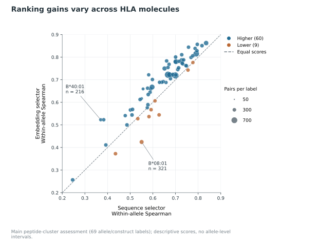

# Frozen Boltz-2 pair representations improve peptide–HLA stability ranking

## Abstract

We tested whether frozen features from Boltz-2 improve within-allele ranking of measured peptide–HLA stability over sequence models. We kept Boltz-2 unchanged and trained small supervised predictors on its features across 19,716 peptide–HLA pairs from one existing assay dataset. Nested cross-validation separated model selection from outer assessment, and the primary comparison applied predefined selection rules across candidate sets. The Boltz-2 feature predictors raised median within-allele Spearman correlation from 0.6668 to 0.7212 (difference +0.0543, conditional 95% interval [+0.0314, +0.0808]). Under joint peptide and HLA holdout with matched nonlinear heads, Boltz-2 pair features reached 0.4980 versus 0.1242 for sequence models. Pair features also outperformed tested chain-average and projected-token features on matched heads. In a separate retrospective adaptation test using 20 existing labels per target allele, ranking improved by +0.0468 (family 98.33% interval [+0.0140, +0.1195]). All stability evaluations reuse one assay cohort, and the intervals are conditional on saved fits and model selection. These comparisons do not establish a physical mechanism, calibrated half-lives, or independent kinetic confirmation.

## Introduction

Peptide–human leukocyte antigen class I (pMHC-I) complex persistence shapes cell-surface antigen presentation, making complex stability a distinct predictive problem from equilibrium binding affinity. Experimental benchmarks quantify this persistence through scintillation-proximity dissociation assays ([Harndahl et al., 2011](https://pubmed.ncbi.nlm.nih.gov/21044632/)). Sequence-based neural networks already model these assay-derived stability measurements: NetMHCstab identified allele-dependent anchor submotifs associated with pMHC-I stability ([Jørgensen et al., 2014](https://pubmed.ncbi.nlm.nih.gov/23927693/)), and NetMHCstabpan extended this framework to pan-specific prediction using the assay collection analyzed here ([Rasmussen et al., 2016](https://pubmed.ncbi.nlm.nih.gov/27402703/)). Because established sequence predictors already capture strong anchor-position signals—and released NetMHCstabpan weights trained on this same assay collection cannot serve as a held-out comparator—testing whether structural representations improve stability ranking requires comparing them against sequence baselines fitted within the same study partitions.

Internal representations from frozen biomolecular structure predictors can be reused for supervised downstream learning without fine-tuning the structure model. AFToolkit showed that AlphaFold-derived embeddings paired with simple adapters support protein-engineering tasks ([Sindeeva et al., 2025](https://pubmed.ncbi.nlm.nih.gov/40622483/)). Similarly, DeorphaNN combined AlphaFold-predicted GPCR–peptide structures and embeddings for agonist screening, finding pair representations informative across retrospective transfer benchmarks and experimental tests ([Ferguson et al., 2026](https://pubmed.ncbi.nlm.nih.gov/42492505/)). Here, Boltz-2 supplies a frozen model for biomolecular structure and affinity prediction ([Passaro et al., 2025](https://doi.org/10.1101/2025.06.14.659707)) whose internal representations can be probed for downstream stability prediction.

We tested which Boltz-2 feature families improve peptide–HLA stability ranking and whether predictions hold when peptides and HLA groups are left out of supervised fitting. We compared sequence models with coordinate and confidence, chain-average, residue-level, and pair features, using positional and pooling controls to test specific feature choices rather than general biological mechanisms. We trained the supervised predictors on existing stability measurements, not on Boltz-2's native affinity output. Because all stability analyses reuse one assay dataset, these comparisons remain development evaluations pending independent confirmation ([Cawley and Talbot, 2010](https://www.jmlr.org/papers/v11/cawley10a.html)).

## Results

### Interface features improve development ranking

We tested whether frozen Boltz-2 representations with ridge or multilayer perceptron (MLP) heads improve within-allele peptide–HLA stability ranking across 19,716 training pairs, 3,587 peptide clusters, and 69 eligible HLA-A/B alleles. We report median within-allele Spearman correlation with 95% intervals conditioned on the saved predictions and selection decisions (Methods). In the prespecified primary contrast, the embedding-or-original selector scored 0.7212 versus 0.6668 for the competitive sequence selector, a paired gain of +0.0543 [0.0314, 0.0808] (Figure 1).

Inner folds selected complete procedures rather than a single global model, choosing the contact-pooled pair representation with an MLP head (R5 MLP) in four outer folds and the groove-averaged directed pair representation with ridge regression (R4 ridge) in one. An inner-selected blend of the original sequence ensemble with R4 ridge reached 0.7238 (+0.0569 [0.0426, 0.0838] over the sequence selector). The following representation, transfer, label-budget, and descriptor analyses are development follow-ups and do not replace the prespecified primary comparison.

**Figure 1 | Stability ranking within and across HLA sequence groups.** Panel A shows reference and candidate scores; panel B shows their paired differences. Rows compare reference and candidate procedures for the prespecified main contrast (diamond; competitive sequence selector versus embedding selector), matched transfer (R0 sequence MLP versus R5 pair-feature MLP) and selected transfer (expanded sequence selector versus embedding selector). Selected procedures use inner model selection, whereas matched MLPs share a common learner recipe but use different input representations. Each row compares procedures within its own assessment rather than across regimes. All rows use the development cohort's 69-allele panel (19,647 eligible rows). Bars indicate conditional 95% bootstrap intervals: whole peptide clusters for the main contrast and crossed peptide/HLA groups for transfer. [Exact values and source rows](manuscript/figure_data.csv).

In the main peptide-cluster assessment (distinct from the unseen-HLA transfer benchmark), within-allele Spearman performance varies across the 69 eligible allele/construct labels (Figure 2). Across these descriptive point scores, the embedding selector improves over the sequence selector on 60 of 69 labels and worsens on 9. The largest increase occurs for HLA-B*40:01 (0.3699 to 0.5229; n = 216 pairs) and the largest decrease for HLA-B*08:01 (0.5505 to 0.4244; n = 321 pairs). Because evaluated alleles are correlated, these counts are not independent trials or significance tests.

**Figure 2 | Per-allele comparison of sequence and embedding selectors in the main peptide-cluster assessment.** Within-allele Spearman correlation for the sequence (x-axis) versus embedding (y-axis) selector across 69 eligible allele/construct labels ([paired allele scores and source record](manuscript/figure2_data.json)). Relative to the equal-performance diagonal, blue points mark higher embedding scores (60 labels) and orange mark lower scores (9 labels). Marker area scales with pair count n (28–727 pairs); callouts identify the largest positive (HLA-B*40:01) and negative (HLA-B*08:01) differences. Points represent descriptive per-allele differences across correlated labels without individual intervals or significance tests, distinct from the difference of panel medians.

### Pair representations outperform the other tested feature families

On the same 69-allele development panel, we compared six representations (R0–R5; Table 1) using matched 64-unit MLP heads with 30 final members ([saved scores](further_research/round2/results/main/pooled_scores.csv), [matched contrasts](further_research/round2/results/main/paired_comparisons.csv), and [feature definitions](../docs/STRUCTURES.md)). Because feature dimensions, input context, and preprocessing still differ across representations, matching the nominal learner recipe neither equalizes information content nor isolates a causal effect of 3D geometry. Positional sequence (R0, 0.5914) is a one-hot-only control distinct from the competitive sequence selector (0.6668), which remains the primary comparator.

| Representation | Inputs retained by the predictor | Dimensions | Median within-allele Spearman |
|---|---|---:|---:|
| Positional sequence (R0) | Peptide and 34-residue HLA pseudosequence, one-hot encoded | 860 | 0.5914 |
| Sequence plus geometry (R1) | R0 plus 109 coordinate and confidence summaries | 969 | 0.6100 |
| Chain averages (R2) | Mean token features for HLA, β2m and peptide | 1,152 | 0.4219 |
| Positional residue features (R3) | Peptide and groove tokens with fixed channel projection | 1,528 | 0.3862 |
| Groove-averaged pair features (R4) | Directed pair features averaged across the groove at each peptide position | 2,304 | 0.7136 |
| Contact-pooled pair features (R5) | Contact subsets summarized at P1, P2, P9 and mean P3–P8 | 1,024 | 0.7210 |

Appending 109 coordinate and confidence summaries to R0 yields an R1–R0 difference of +0.0186 (conditional 95% interval [-0.0113, +0.0375]), showing no established increment from these geometry and confidence summaries under this recipe. Directed pair representations (R4, 0.7136; R5, 0.7210) are the strongest feature families in this tested ladder, whereas the tested token encodings (R2, R3) perform worse, though this does not prove all possible token encodings fail.

### Token-position and pair-pooling comparisons across representation controls

To assess how positional indexing and spatial pooling affect ranking within specific feature families, we compared matched ablations (Figure 3). For projected residue-level features, preserving residue order (`R3_mlp`, 0.3862) outperformed mean-pooled tokens (`R3_pooled_mlp`, 0.0475) by +0.3387 [0.3029, 0.3773], demonstrating useful positional information relative to the matched pooled control. Nevertheless, the projected token model remained below the competitive sequence selector (0.6668).

Within the fixed projected pair interface, retaining the full 9×34 groove interface across all 34 groove residues achieved 0.7315 versus 0.5652 for a dimension-matched pooled-pair control that averaged only contact-mask-selected residues and tiled the pooled summary (+0.1663 [0.1378, 0.1992]); because residue coverage and positional resolution changed together, this contrast cannot isolate a positional effect. Retaining the full positional pair interface showed no established advantage over the compact R5 summary (+0.0106 [-0.0142, 0.0220]). Within R5, pooling over reference crystal-contact subsets (0.7210) versus a shuffled-contact control across the same 34 HLA positions (0.7203) likewise showed no established advantage under this recipe (+0.0007 [-0.0096, 0.0236]).

**Figure 3 | Positional resolution and contact-mask choice.** Reference and candidate procedures are matched within each row. The token comparison either preserves or pools residue positions under a fixed projection, whereas the pair-interface comparison contrasts all 34 groove positions with contact-restricted pooling while retaining peptide positions. Because the latter alters both residue coverage and positional detail, it does not isolate a groove-position effect. The contact-mask comparison varies HLA contact membership within the R5 construction. Absolute scores are shown alongside paired gains so that improvement over a weak control is not mistaken for performance above the sequence selector. Bars indicate pointwise conditional 95% peptide-cluster bootstrap intervals on the same 69-allele panel. The contact-mask interval spans zero, and equivalence is not established. [Exact values and source rows](manuscript/figure_data.csv).

### Pair representations transfer across held-out HLA groups and peptide clusters

In peptide-cluster splits, the same HLA alleles appear in both training and evaluation sets. Holding out entire HLA groups tests whether predictors generalize to HLA alleles excluded from downstream head fitting (Figure 1). Under HLA-group holdout, matched R5 MLP scored 0.5667 versus 0.1605 for matched sequence MLP (R0 MLP; +0.4062 [0.3073, 0.4733]), and the embedding selector exceeded the expanded sequence selector by +0.3542 [0.2762, 0.4563]. Under joint peptide-cluster and HLA-group holdout with crossed resampling, matched R5 MLP reached 0.4980 versus 0.1242 for matched R0 MLP (+0.3738 [0.3092, 0.4638]), while the embedding selector led the expanded sequence selector by +0.3982 [0.3143, 0.4613].

Although these nonlinear comparisons address the additive sequence-ridge limitation, they still evaluate complete predictive procedures that differ in inputs, feature dimensions, molecular context, and pretraining. Furthermore, excluding HLA groups from supervised fitting does not establish that related structures were absent from Boltz-2 pretraining. The expanded sequence selector was also not uniformly stronger than the original ensemble: under joint holdout, it scored 0.1085 versus 0.1350 for the original sequence reference.

### Label-budget robustness and target-allele adaptation

We next tested retrospective sensitivity to smaller training budgets across 25%, 50%, and 100% of fitting clusters (including stopping labels) using separate fixed two-member MLP recipes for sequence and pair-interface inputs; this fixed sequence recipe is weaker than the main competitive sequence selector. Cutting fitting clusters from 100% to 25% lowered sequence scores from 0.5373 to 0.2640, while pair-interface scores dropped from 0.6995 to 0.5877, widening the pair-interface lead at 25% by +0.1615 [0.1333, 0.2041] relative to 100%. This wider gap reflects retrospective robustness to fewer training clusters, not prospective assay savings.

In a retrospective few-shot study across 68 alleles and three fixed support designs, we fitted target-specific residual adapters using 20 existing labels per allele (1,360 per design). Source predictors remained fixed and had been fitted without the target HLA group or the support/query peptide families (Figure 4). Adapting R5 ridge improved median correlation from 0.5296 (zero-shot) to 0.5763 at 20 labels (+0.0468 [0.0227, 0.1035]; three-primary family-adjusted 98.3333% interval [0.0140, 0.1195]), while a reduced four-member sequence reference (distinct from the competitive selector) rose from 0.0830 to 0.2058. Full adaptation outperformed an exploratory offset control specific to each allele and fitted joint cell (+0.0444 [0.0165, 0.0928]), whereas offset-only adjustment—which can alter rankings when predictions are pooled across cells even though each within-cell ordering is unchanged—showed no established improvement over zero-shot prediction (+0.0024 [-0.0062, 0.0239]).

**Figure 4 | Adaptation using existing target-allele labels.** Curves show the mean of design-specific median within-allele Spearman scores across three fixed support designs on 68 target alleles under joint HLA/peptide holdout. Source fitting excludes the target HLA group and support/query peptide families, and target labels fit residual adapters on fixed source predictors. The four-member sequence MLP serves as a reduced reference and sequence ridge as an additive sensitivity control; neither represents the main competitive sequence selector. Curve uncertainty bands were not estimated. The displayed interval for the 20-versus-zero-label R5 gain is conditional and adjusted to 98.33% for the three-primary follow-up family. [Exact curves, interval and source record](manuscript/figure4_data.json).

### Secondary descriptors and ranking heads show no established improvement

Finally, we tested whether external structural descriptors or alternative ranking heads improve predictions within the development cohort. On a balanced 4,449-pair panel with matched two-member heads, adding ProteinMPNN complex-context scores C to R5 plus peptide-only scores P (R5+P+C versus R5+P; +0.0240; family-adjusted 98.3333% interval [-0.0219, 0.0659]) or adding repaired FoldX terms E to R5 (R5+E versus R5; +0.0150; family-adjusted 98.3333% interval [-0.0524, 0.0450]) produced no established improvement within the same three-primary family as the adaptation test. Evaluating the selected R5+P+C specification against R5 alone across the full cohort as a secondary check likewise showed an uncertain difference (-0.0070; pointwise 95% interval [-0.0220, 0.0131]).

Alternative ranking objectives and selection rules also yielded uncertain differences. A pairwise RankNet loss (+0.0071 [-0.0051, 0.0098]) and a hybrid selector (+0.0044 [-0.0055, 0.0100]) each showed no established improvement in ranking accuracy. Although these non-significant differences do not establish equivalence or a universal failure of external descriptors, within our fitted procedures and assay cohort they show no established improvement from added descriptor or head complexity over simple regularized readouts of the frozen pair interface.

### Earlier and secondary studies

The following earlier and secondary studies use different splits, populations, or endpoints; they are reported on their own benchmarks and do not provide matched comparisons with the main Boltz-2 pair-feature models.

#### Sequence predictions distinguish eluted ligands

We tested whether the original sequence stability ensemble—used without retraining or refitting on presentation labels—separates observed eluted peptide–HLA pairs from comparison pairs across 51 HLA alleles in the MHC Motif Atlas ([elution results](stage3c_summary.csv), [dataset provenance](stage3c_provenance.json), and [elution details](REPORT.md#sequence-predictions-transfer-to-ligand-presentation)). After excluding all 5,633 unique peptide sequences in the stability dataset from both classes, the benchmark comprised 81,600 observed nine-residue peptide–HLA pairs and 816,000 human-proteome comparison pairs (10 random decoys per observed pair). The sequence predictor achieved a median per-allele area under the receiver operating characteristic curve (AUROC) of 0.9656 and area under the precision–recall curve (AUPRC) of 0.7804.

In specificity controls, using eluted ligands from other alleles as decoys yielded a median AUROC of 0.9157, whereas permuting the HLA pseudosequence lowered median AUROC to 0.6965. These controls measure sensitivity to decoy construction and allele inputs, and the decoy pairs are not verified negative observations. This sequence-model benchmark does not test the Boltz-2 pair-feature benefit, independently validate kinetic predictions, or assess immunogenicity.

#### Earlier ESM-2 and coordinate-feature comparisons

We compared the baseline sequence ensemble against frozen ESM-2 features and an earlier Boltz coordinate-and-confidence pipeline on the original 5,633-row test partition ([scores](stage6_test_summary.csv), [paired comparisons](stage6_test_paired_ci.csv), and [earlier feature comparisons](REPORT.md#earlier-sequence-and-pretrained-feature-comparisons)). This partition contains 5,565 scoring rows across 67 eligible alleles. Because it was exposed during earlier diagnostics, it is not an untouched confirmation set.

| Procedure | Median within-allele Spearman | Paired difference vs sequence reference (conditional 95% interval) |
|---|---:|---:|
| Sequence ensemble (peptide + HLA pseudosequence) | 0.7064 | Reference |
| Frozen ESM-2 ensemble | 0.6979 | -0.0085 [-0.0291, +0.0233] |
| Sequence + ESM-2 ensemble | 0.6816 | -0.0248 [-0.0460, +0.0073] |
| Older sequence + Boltz geometry/confidence pipeline | 0.5947 | -0.1117 [-0.1339, -0.0575] |

Neither ESM-2 variant established a gain over the sequence reference, and intervals crossing zero do not establish equivalence. The older Boltz geometry-and-confidence pipeline performed worse, but it also changed the sequence encoding, preventing isolation of coordinate effects. Because the evaluation population, feature definitions, and protocol differ from the nested development benchmarks, these scores do not provide a matched comparison between ESM-2 and the current Boltz-2 pair representations.

#### Sequence distance and binding-affinity context

In an earlier leave-one-allele-out sequence study across 22,533 combined training and validation rows (68 eligible alleles, without original-test evaluation), within-allele ranking declined as held-out alleles diverged from the training set in 34-residue HLA pseudosequence ([sequence allele-holdout results](stage7_allele_holdout_headline_seq_pep_pseudo.json) and [transfer and affinity details](REPORT.md#earlier-allele-transfer-and-affinity-analyses)). Median within-allele Spearman correlation was 0.7415 across 25 held-out alleles differing by at most one pseudosequence residue from the nearest training allele (Hamming distance ≤1) versus 0.3390 across 20 alleles differing by at least four residues (distance ≥4). Across held-out alleles, the median share of evaluated peptides already observed under at least one training allele was 1.0, and allele composition varied across distance strata; this pattern is therefore a descriptive association rather than a causal distance effect or a joint peptide–HLA holdout result.

Separately, across 5,135 dual-measured pairs (33 eligible of 55 alleles), affinity-based rankings showed a median within-allele Spearman association of 0.5801 with measured stability ([affinity association](stage2c_affinity_ceiling.csv)). This statistic reflects an empirical association between the two measurements rather than a ceiling on attainable prediction accuracy.

#### Recorded zero-label probability calibration

Across five outer peptide-cluster folds of the 19,716-row training partition (69 eligible alleles, without original-test evaluation), we fitted sequence models to continuous stability measurements using alternative regression objectives and converted the ensemble outputs into probabilities of recorded zero labels ([pooled scores](further_research/phase_b_pooled.csv), [paired contrasts](further_research/phase_b_paired.csv), and [zero-label calibration](REPORT.md#calibration-of-recorded-zero-labels)). For probability metrics pooled across all 19,716 held-out rows, replacing `log1p` mean-squared-error (MSE) fitting and MSE stopping (B0) with Gaussian censored negative log-likelihood (NLL) fitting and MSE stopping (B2) lowered Brier score from 0.1099 to 0.0935 (reduction 0.0165, pointwise conditional 95% interval [0.0151, 0.0179]) and fixed-bin expected calibration error from 0.0643 to 0.0196 (lower is better).

Across the same 19,716 rows, however, `log1p` mean absolute error (0.4865 to 0.5442) and censored NLL (1.0714 to 1.1120) worsened, and median within-allele Spearman correlation across the 69 eligible alleles moved from 0.6604 to 0.6497 (difference -0.0108 [-0.0242, +0.0036]), an uncertain change compatible with modest ranking loss rather than proven preservation. Treating values below 0.1 h as censored is a modelling convention rather than an observed assay threshold, and these probabilities target recorded zero labels of unknown experimental origin rather than calibrated physical half-lives.

## Discussion

The observed ranking benefit applies to this dataset and to HLA groups held out from supervised predictor fitting. The tested pair features outperformed chain averages and projected tokens. Adding R1 geometry and confidence features was inconclusive specifically with matched multilayer perceptrons. In the tested comparisons, neither the full 9x34 pair grid versus compact R5 nor the crystal-contact mask versus a shuffled mask had an established advantage. Comparing the full grid with the contact-restricted pooled control alters both residue coverage and position, and the feature families also differ in input dimensions, chain context, and model capacity. These controls do not isolate a causal 3D contact mechanism.

Pretrained-feature performance can depend on the prediction task ([Chauhan, 2026, preprint](https://arxiv.org/abs/2606.04228)). In our sequence-regression experiments, censored-likelihood fitting improved probability calibration for recorded zero labels at the expense of continuous-error metrics and without assured ranking preservation. Moreover, calibrating probabilities of recorded zeros does not calibrate physical half-lives, because zero entries can reflect rapid dissociation, failed complex formation, assay limits, or censoring.

Supervised HLA holdout does not establish that held-out alleles were absent from Boltz-2 pretraining, and Boltz-2 uses fuller chain context than peptide and pseudosequence baselines. The label-budget and adaptation studies used weaker sequence references. Adaptation used 20 existing labels per allele; neither study measured prospective assay savings. Moreover, the dataset was partly selected using binding predictions, and rank correlation does not establish calibrated physical half-lives or off-rates.

Earlier diagnostic test exposure and reuse of the stability cohort are also limitations. The conditional intervals omit variation from refits, candidate search, and new assay runs, and non-significant descriptor or head comparisons do not prove equivalence. Independent kinetic validation is still needed.

## Methods

### Measurements and assessment population

The source dataset comprises 28,166 peptide–HLA pairs across 5,633 nine-residue peptides and 75 HLA-A/B alleles or constructs, including three C67S constructs ([Rasmussen et al., 2016](https://pubmed.ncbi.nlm.nih.gov/27402703/)). Candidate peptides were selected partly by NetMHCpan 2.8 predicted affinity (<500 nM or top 2% rank), and the source modelling cohort retained molecules with at least one stable and two nonstable observations using a two-hour threshold. Consequently, the cohort is enriched for predicted binders rather than representing a random peptide repertoire.

Reported half-lives are geometric means from two independent experiments in a scintillation proximity assay tracking labelled β2-microglobulin dissociation as a proxy for complex persistence ([Harndahl et al., 2011](https://pubmed.ncbi.nlm.nih.gov/21044632/)). The supplied table lacks separate replicate observations, raw curves and measurement-level failure or censoring flags. Approximately 20% of the labels are zero, and rapid dissociation, failed complex formation and other measurement limits cannot be distinguished. We retained the recorded labels and used the natural-log transformation `log1p(thalf_hours)` as the regression target, whereas ranking procedures used their declared objectives.

We constructed a fixed study split containing 19,716 training, 2,817 validation, and 5,633 test rows. Peptides are grouped across alleles by single-linkage clustering at Hamming distance ≤3, with each connected component confined to a single partition. The main, transfer, label-budget, adaptation and descriptor assessments use the original training partition, which comprises 3,587 peptide clusters. An earlier diagnostic repartitioned the corpus, using 3,350 original test rows for fitting, 448 for stopping and 585 for scoring. Because those exposures and repeated use of the development cohort informed subsequent research choices, nested assessment does not restore independent confirmation. The [evaluation protocol](../EVALUATION.md) documents this history and all partition rules.

### Frozen representations and downstream predictors

Boltz-2 ([Passaro et al., 2025](https://doi.org/10.1101/2025.06.14.659707)) was used to process HLA ectodomain–β2-microglobulin–peptide inputs for the 19,716 training rows via `boltz==2.1.1`, where the package version differs from the Boltz-2 model family. From each input, we extracted frozen final-trunk single-token (`s`) and directed-pair (`z`) states before the output heads. These internal representations are distinct from coordinate-derived descriptors, and stability labels train downstream prediction heads rather than the structure model.

The sequence ensemble uses one-hot and BLOSUM encodings of the peptide and the 34-residue HLA pseudosequence, whereas the matched R0 representation uses positional one-hot features only (860 dimensions). Main selection ([sequence protocol](further_research/round2/sequence/protocol.json)) evaluates original and allele-centred neural and tree procedures alongside a pairwise ranker; the main sequence MLP uses hidden layers of 256 and 64 units. The embedding selector ([embedding protocol](further_research/round2/embedding/protocol.json)) evaluates ridge and MLP procedures on frozen features while retaining the original sequence ensemble as a fallback; the feature MLP uses one 64-unit hidden layer.

Representation comparisons span chain averages, projected residue-level features and directed pair features. R3 preserves peptide and groove positions under a fixed, label-independent projection (1,528 dimensions). R4 averages all 128 pair channels in each direction across 182 groove residues at each peptide position (2,304 dimensions). R5 pools over contact subsets within 34 HLA positions, retaining P1, P2 and P9 separately while averaging P3–P8 (1,024 dimensions); its fixed mask is the union of heavy-atom contacts within 4.5 Å across five reference crystals.

The full 9 × 34 positional interface projects the 128 pair channels in each direction to four, producing 2,448 features while retaining all 34 groove residues at each peptide position. Its dimension-matched control instead pools only contact-mask-selected residues at each peptide position and tiles the resulting summary across groove columns. Because peptide positions are preserved while groove coverage and positional resolution change simultaneously, this comparison cannot attribute performance gains to groove-position detail alone. R3 is paired with a separate tiled pooled-token control under the same projection, and an R5 control shuffles HLA contact membership. These controls match nominal dimensions and projections within each comparison, but they do not equate information content across feature families. The [representation guide](../docs/STRUCTURES.md) links the exact tensor definitions, extraction versions and hashes.

### Model selection and transfer

Five outer peptide-cluster folds generate held-out predictions. Within each fitting partition, three inner folds select model configurations and procedures, with stopping, scaling and centring restricted to permitted fitting data. Main selection uses the mean of inner-fold median correlations and a one-standard-error rule with a fixed preference order. MLP screening uses 12 ensemble members for sequence models and two for feature models, whereas final main-study MLP ensembles use 30. Outer-fold results do not select a new global winner. Exact candidate grids and recipes are preserved in the [evaluation protocol](../EVALUATION.md).

HLA pseudosequences form 35 connected groups at Hamming distance ≤3—with each construct and its corresponding wild-type name assigned together—and are allocated to five balanced folds. HLA holdout excludes the target group, whereas joint holdout evaluates all 25 HLA-fold × peptide-fold cells while excluding both held-out axes and their cross quadrants from fitting. Inner selection and stopping respect the same grouping axes. Matched transfer heads share learner recipes, grids, and selection and stopping rules, although feature dimensions and parameter counts differ. Within a fitted additive sequence-ridge model, HLA features alter an offset without changing peptide ordering; nonlinear sequence comparisons therefore carry greater weight. Supervised HLA exclusion does not establish that related structures were absent from foundation-model pretraining. Pooled joint predictions come from separately fitted cells with potentially different scales and no outcome-based recalibration was applied, limiting the interpretation of pooled rankings and offset controls.

### Label budgets, adaptation and descriptors

The label-budget assessment uses separate, fixed two-member MLP recipes trained on predefined 25%, 50% and 100% subsets of the outer-fitting peptide clusters, counting stopping labels and averaging scores across the predetermined subset designs. These sequence recipes are weaker than the main competitive selector.

The few-shot assessment uses the 25 joint cells and three fixed support designs across 68 target alleles. Budgets of 0, 5, 10 and 20 labels form nested prefixes of a maximum support set of 20 peptide clusters per allele. The union of maximum-support clusters across all target alleles is excluded from both source fitting and queries, and source fitting additionally excludes the target HLA and query peptide folds. Within each design, query identities remain fixed across budgets and arms. Fixed R0/R5 source ridge models use an alpha of 100, whereas target-specific residual ridge adapters use an alpha of 1 and an intercept on source-scaled features divided by the square root of the feature dimension. Target labels do not tune hyperparameters or stopping, whereas source stopping labels count toward access. The sequence anchor is a separate four-member MLP. Primary adaptation effects are computed by averaging design-specific score differences rather than pooling predictions across designs.

Descriptor comparisons use a balanced 4,449-row panel with matched two-member heads and ridge sensitivities. ProteinMPNN uses the full-backbone checkpoint `v_48_020.pt` with zero added coordinate noise to supply nine position-wise scores for each of the peptide-only and full-complex contexts, averaged across 16 common decoding orders ([Dauparas et al., 2022](https://pubmed.ncbi.nlm.nih.gov/36108050/)). Because the peptide backbone was predicted in the native complex, the peptide-only input does not represent context-free geometry. FoldX runs `RepairPDB` and `AnalyseComplex` while retaining β2m to produce 29 repaired energy/interface descriptors ([Delgado et al., 2019](https://pubmed.ncbi.nlm.nih.gov/30874800/)). The primary ProteinMPNN contrast adds full-complex scores to R5 plus peptide-only scores (R5+P+C minus R5+P), whereas the FoldX contrast is R5+E minus R5. The full-cohort ProteinMPNN extension, which compares R5+P+C against R5, was selected after the panel results and remains a secondary development assessment. Complete settings and ancestry are linked in the [source-table index](README.md).

### Endpoint and uncertainty

The primary endpoint is the median of within-allele Spearman correlations on pooled held-out predictions, computed with average ranks for ties and equal allele weight. Eligibility requires at least 20 rows and two distinct labels, yielding 69 alleles and 19,647 scoring rows in the main/transfer panels; the ≥50-row sensitivity panel contains 68 alleles and 19,619 rows. Under the declared rule, constant predictions contribute zero, and bootstrap draws that lose label variation omit the affected allele from all arms. Few-shot panels use the intersection of eligibility across the fixed query designs. Contrasts subtract panel medians using unrounded values, while displayed values are reported to four decimal places.

Intervals use 2,000 paired bootstrap draws of whole peptide clusters; transfer and adaptation analyses additionally resample actual HLA groups, carrying group multiplicities into rows and allele medians. Folds are not biological sampling units. These intervals condition on saved predictions, selections and support designs, omitting refitting, repeated search, new support acquisition and new assay variation. Adaptation, ProteinMPNN context and FoldX energy form a three-primary family evaluated with Bonferroni-adjusted 98.3333% intervals. All other intervals are pointwise, unadjusted 95% intervals, and this family correction does not cover the broader adaptive research programme ([Cawley and Talbot, 2010](https://www.jmlr.org/papers/v11/cawley10a.html)).

## Data and code availability

Curated measurements, split assignments, saved predictions, comparison tables, and frozen protocols are listed in the [data guide](../docs/DATASETS.md), [evaluation protocol](../EVALUATION.md), and [evidence index](README.md), with additional scores, sensitivity checks, and historical benchmarks in the [supplementary results](REPORT.md). Figure 2 summarizes saved per-allele scores and computes simple differences and counts, while Figures 1, 3, and 4 copy saved summary estimates directly. [Figure source data and reproduction instructions](manuscript/README.md) record the exact input rows and file hashes.

Exported development-refit predictors take compatible cached Boltz-2 features and output uncalibrated log-scale predictions, but they do not reproduce the nested cross-validation selector or inherit its held-out score. Large feature caches are not stored in Git. The [inference guide](../docs/ROUND2_INFERENCE.md) describes feature extraction for new sequences as a separate step, but the repository provides no public feature-cache download or documented end-to-end command to extract features from new sequences, and the saved training feature manifest contains author-local paths. Users can verify saved results and figures from the repository and run exported predictors only when compatible feature caches are already available locally. The [cache audit](further_research/round2/resources/cache_completion_audit.json) also notes that the fanout wrapper's recorded launch hash differs from its retained source hash. Frozen extraction script hashes and feature checks match, but the exact launch-time wrapper bytes cannot be verified.

The [compute and inference scope](REPORT.md#compute-and-inference-scope) summary reports shared trunk-feature extraction cost and warm cached-head timing separately. End-to-end latency and cost for uncached new peptide–HLA sequences were not measured.

## References

- Harndahl, M., Rasmussen, M., Roder, G. et al. (2011). Real-time, high-throughput measurements of peptide–MHC-I dissociation using a scintillation proximity assay. *Journal of Immunological Methods*. [PubMed](https://pubmed.ncbi.nlm.nih.gov/21044632/).
- Jørgensen, K. W., Rasmussen, M., Buus, S. et al. (2014). NetMHCstab—predicting stability of peptide–MHC-I complexes; impacts for cytotoxic T lymphocyte epitope discovery. *Immunology*. [PubMed](https://pubmed.ncbi.nlm.nih.gov/23927693/).
- Rasmussen, M., Fenoy, E., Harndahl, M. et al. (2016). Pan-specific prediction of peptide–MHC class I complex stability, a correlate of T cell immunogenicity. *Journal of Immunology*. [PubMed](https://pubmed.ncbi.nlm.nih.gov/27402703/).
- Passaro, S., Corso, G., Wohlwend, J. et al. (2025). Boltz-2: Towards accurate and efficient binding affinity prediction. *bioRxiv*, preprint. [DOI](https://doi.org/10.1101/2025.06.14.659707).
- Sindeeva, M., Telepov, A., Ivanisenko, N. et al. (2025). AFToolkit: a framework for molecular modeling of proteins with AlphaFold-derived representations. *Briefings in Bioinformatics*. [PubMed](https://pubmed.ncbi.nlm.nih.gov/40622483/).
- Ferguson, L., Ouellet, S., Vandewyer, E. et al. (2026). DeorphaNN: Virtual screening of GPCR peptide agonists using AlphaFold-predicted active-state complexes and deep learning embeddings. *Molecular Cell*. [PubMed](https://pubmed.ncbi.nlm.nih.gov/42492505/).
- Chauhan, K. (2026). When does structure help? The information bonus of AlphaFold2 representations over protein language models. *arXiv*, preprint. [arXiv](https://arxiv.org/abs/2606.04228).
- Dauparas, J., Anishchenko, I., Bennett, N. et al. (2022). Robust deep learning-based protein sequence design using ProteinMPNN. *Science*. [PubMed](https://pubmed.ncbi.nlm.nih.gov/36108050/).
- Delgado, J., Radusky, L. G., Cianferoni, D. and Serrano, L. (2019). FoldX 5.0: working with RNA, small molecules and a new graphical interface. *Bioinformatics*. [PubMed](https://pubmed.ncbi.nlm.nih.gov/30874800/).
- Cawley, G. C. and Talbot, N. L. C. (2010). On over-fitting in model selection and subsequent selection bias in performance evaluation. *Journal of Machine Learning Research* 11, 2079–2107. [Article](https://www.jmlr.org/papers/v11/cawley10a.html).
