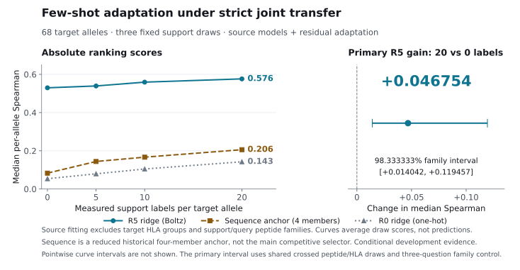

# Internal Structural Foundation Model Representations Improve Peptide–HLA Class I Kinetic Stability Prediction and Cross-Allele Transfer

## Abstract

The kinetic stability of a peptide–HLA class I (pMHC-I) complex—quantified by its dissociation half-life ($t_{1/2} = \ln 2 / k_{\text{off}}$)—governs how long an antigen remains displayed at the cell surface for T-cell recognition and provides information distinct from equilibrium binding affinity ($K_d = k_{\text{off}} / k_{\text{on}}$; within-allele Spearman $\rho = 0.580$ across $7,281$ dual-labeled pairs). While sequence-based neural networks predict within-allele stability well for densely characterized HLA alleles, it remains unclear when and why protein foundation models improve upon sequence baselines. Here we systematically evaluate sequence ensembles, protein language models (ESM-2), biomolecular structure predictors (Boltz-2), inverse-folding likelihoods (ProteinMPNN), and empirical force-field energies (FoldX) across **28,166** experimentally measured 9-mer peptide–HLA complexes spanning **75** HLA alleles (Rasmussen et al., 2016) and **897,600** evaluated pairs in an external immunopeptidomics ligand elution benchmark across **51** alleles (MHC Motif Atlas).

First, on the held-out peptide-cluster test split ($5,565$ pairs, $67$ alleles), a 30-model multilayer perceptron (MLP) ensemble using the 9-mer peptide and 34-residue HLA contact pseudosequence achieves a median within-allele Spearman $\rho$ of **0.7064**, outperforming a single network by $+0.0883$ ($\rho = 0.6181$) and matching a full 182-residue HLA domain ensemble ($\rho = 0.6904$). Evaluated zero-shot on $81,600$ mass-spectrometry-eluted ligands against $816,000$ proteome decoys across $51$ alleles, this stability predictor reaches a median **AUROC of 0.9656** (AUPRC $0.7804$), retains **0.9157 AUROC** against allele-swapped eluted-ligand decoys that control for generic peptide presentability, and drops to **0.6965** when HLA pseudosequences are permuted. By contrast, naive foundation-model features fail to beat the sequence ensemble on the stability test split: frozen **ESM-2** embeddings tie the baseline ($\rho = 0.6979$, $\Delta\rho = -0.0085$), and compressing $28,166$ predicted **Boltz-2** structures ($143.6$ A10G GPU-hours) into hand-engineered pocket geometry and confidence summaries degrades ranking to **0.5947** ($\Delta\rho = -0.1117$).

Second, we show that the failure of coarse structural features is a representation bottleneck rather than a limitation of the folding model. Extracting **position-aware peptide–groove pair representations** directly from the frozen Boltz-2 trunk (`R4` and `R5`) preserves residue-specific anchor conditioning that global pooling destroys. In nested 5-fold peptide-cluster cross-validation across the $19,716$-pair training cohort ($3,587$ peptide clusters, $69$ alleles), a pre-specified Boltz-2 embedding selector achieves $\rho = \mathbf{0.7212}$ versus $\rho = \mathbf{0.6668}$ for a competitive sequence selector spanning standard and allele-centered MLP ensembles, boosted trees, and pairwise rankers (**$\Delta\rho = +0.0543$**, $95\%$ CI $[+0.0314, +0.0808]$). Full $9 \times 34$ positional interface features reach **0.7315**, and a linear blend of Boltz-2 ridge predictions with the sequence ensemble reaches **0.7238** ($\Delta\rho = +0.0569$). Controlled ablations demonstrate that preserving individual peptide positions improves ranking by **$+0.3387$** ($[+0.3029, +0.3773]$) over dimension-matched pooled tokens, whereas a crystal-derived contact mask offers no advantage over shuffled HLA contact subsets ($\Delta\rho = +0.0007$ $[-0.0096, +0.0236]$).

Third, Boltz-2 interface representations provide their largest advantage when transferring across the HLA binding groove. Under leave-one-HLA-group-out cross-validation, sequence MLPs collapse ($\rho = 0.1605$), whereas matched Boltz-2 `R5` MLPs reach **0.5667** (**$\Delta\rho = +0.4062$**, $95\%$ CI $[+0.3073, +0.4733]$); under simultaneous peptide-cluster and HLA-group holdout, ranking improves from $0.1242$ to **0.4980** (**$\Delta\rho = +0.3738$** $[+0.3092, +0.4638]$). Adapting a frozen `R5` ridge head with **20 measured peptides** per held-out allele further lifts joint-holdout ranking from **0.5296** to **0.5763** (**$\Delta\rho = +0.0468$**, $95\%$ CI $[+0.0227, +0.1035]$, $98.33\%$ Bonferroni CI $[+0.0140, +0.1195]$). Adding ProteinMPNN log-likelihoods, FoldX energies, or pairwise ranking losses yields no further gain beyond Boltz-2 trunk features.

---

## 1. Introduction

CD8$^+$ T cells surveil intracellular proteomes by recognizing short peptides (predominantly 9-mers) bound within the polymorphic groove of human leukocyte antigen class I (HLA-I) heavy chains non-covalently associated with $\beta_2$-microglobulin ($\beta_2\text{m}$). For a peptide–HLA complex to prime or trigger a T-cell response, it must assemble in the endoplasmic reticulum, traffic to the plasma membrane, and persist on the cell surface long enough to encounter rare cognate T-cell receptors. While computational immunology has historically focused on equilibrium binding affinity ($K_d = k_{\text{off}} / k_{\text{on}}$) or mass-spectrometry (MS) ligand elution, kinetic complex stability—measured by the dissociation half-life $t_{1/2} = \ln 2 / k_{\text{off}}$—is a more direct correlate of immunogenicity and cell-surface longevity (Harndahl et al., 2012; Rasmussen et al., 2016). Two peptides with identical equilibrium affinity can differ substantially in their association ($k_{\text{on}}$) and dissociation ($k_{\text{off}}$) rates; empirically, across $7,281$ construct-compatible peptide–HLA pairs measured for both binding affinity and dissociation half-life, experimental affinity ranks stability with a median within-allele Spearman correlation of only $\rho = 0.580$ ([`reports/stage2c_affinity_ceiling.csv`](stage2c_affinity_ceiling.csv)).

Predicting kinetic stability from sequence and structure poses a sharp modeling question. Within a well-sampled HLA allele, 9-mer binding stability is heavily influenced by primary anchor compatibility at peptide positions P2 and P9 (and auxiliary anchors such as P1 and P3), allowing compact sequence neural networks to achieve competitive accuracy. However, sequence-only models face two fundamental limitations:
1. **Cross-allele generalization**: When predicting stability for rare, under-sampled, or unseen HLA alleles, sequence models must infer how substitutions in the 34 polymorphic groove residues alter pocket electrostatics and steric complementarity—an interaction that additive or shallow sequence encodings struggle to extrapolate across allele families.
2. **Representation bottlenecks in structural foundation models**: Modern protein language models (e.g., ESM-2) and biomolecular structure predictors (e.g., AlphaFold3, Boltz-2) encode rich evolutionary and geometric constraints. Yet in high-throughput peptide–MHC screening, candidate peptides are only 9 residues long and share the same canonical backbone trace inside the MHC groove. Consequently, global sequence pooling, predicted confidence scalars (pLDDT, ipTM, PAE), or coarse 3D distance summaries may wash out subtle residue-specific energetics or introduce coordinate noise across stochastic structure-prediction seeds.

In this study, we dissect where sequence models suffice, why naive foundation-model summaries fail, and how internal position-aware representations from a frozen structure-prediction trunk overcome both limitations. Note that existing published stability predictors such as NetMHCstabpan (Rasmussen et al., 2016) were trained directly on the complete scintillation proximity assay dataset analyzed here and therefore cannot be used as leak-free external comparators. Instead, we benchmark a broad family of leak-free sequence predictors (30-network MLP ensembles, allele-centered networks, gradient-boosted decision trees, and pairwise rankers), test zero-shot biological transfer to $897,600$ peptide–HLA pairs from the MHC Motif Atlas, and evaluate a hierarchy of representations extracted from ESM-2, Boltz-2, ProteinMPNN, and FoldX under strict peptide-cluster and HLA-group cross-validation.

---

## 2. Dataset, Experimental Design, and Representation Hierarchy

### 2.1 Kinetic Stability Dataset and Assay Properties

All supervised stability experiments use the proximity-based dissociation dataset of Rasmussen et al. (*J. Immunol.*, 2016; curated in [`data/rasmussen_et_al_dataset.csv`](../data/rasmussen_et_al_dataset.csv) from `data/raw/dtu_stability_data.xlsx` / `data/processed/stability.parquet`). The curated dataset comprises **28,166** unique `(allele_raw, peptide)` records across **5,633** 9-mer peptides of canonical amino acids and **75** HLA class I allele strings (**72** wild-type alleles spanning 26 HLA-A, 34 HLA-B, 11 HLA-C, and 1 HLA-E\*01:01, plus **3** engineered disulfide-stabilized constructs: `HLA-A*02:01 C67S`, `HLA-A*24:02 C67S`, and `HLA-B*07:02 C67S`). Engineered constructs retain their mutated heavy-chain sequences for structure prediction and domain embeddings while mapping to their parent canonical contact pseudosequence where appropriate (see [`docs/DATASETS.md`](../docs/DATASETS.md)).

The underlying scintillation proximity assay (SPA) measures the dissociation of radiolabeled $^{125}\text{I}$-$\beta_2\text{m}$ from recombinant streptavidin-captured pMHC-I complexes at $37\,^\circ\text{C}$ following excess unlabeled $\beta_2\text{m}$ chase, reporting $t_{1/2}$ in hours as the geometric mean of two independent replicates. Because $\beta_2\text{m}$ release rapidly follows peptide dissociation, $\beta_2\text{m}$ off-rate serves as a high-throughput proxy for pMHC-I kinetic stability. Targets are modeled on a stabilized logarithmic scale ($y = \log_{10}(1 + t_{1/2})$ in the `pepstab` pipeline, or $y_{\text{cens}} = \log_{10}(\max(t_{1/2}, 0.01))$ in Stage I censored regression; because both are strictly monotonic transformations of $t_{1/2} \ge 0$, within-allele Spearman rank correlations $\rho$ are identical), with an indicator `is_zero` marking the **5,693** records (**20.21%**) recorded at $t_{1/2} = 0\text{ h}$, which reflect complexes below the measurable stability floor or rapid initial dissociation.

### 2.2 Homology-Aware Splitting and Evaluation Regimes

To prevent homologous peptide leakage between training and evaluation sets, all 5,633 unique 9-mers were partitioned into connected components under single-linkage clustering at **Hamming distance $\le 3$** ($\ge 66.7\%$ sequence identity). Clusters were assigned to a fixed 70 / 10 / 20 split ([`data/splits.csv`](../data/splits.csv)):
- **Training cohort**: **19,716** pairs (**70.0%**) across **3,587** peptide clusters and **75** alleles (**69** eligible alleles with $\ge 20$ rows and $\ge 2$ unique $y$ values; the 6 alleles with $<20$ rows—`HLA-A*02:02`, `HLA-A*02:05`, `HLA-A*02:07`, `HLA-A*02:11`, `HLA-A*68:01`, and `HLA-B*58:01`—contribute to training but are excluded from per-allele median summaries). In this cohort, the $\ge 20$-row and $\ge 50$-row eligibility criteria select the exact same 69 alleles.
- **Validation split**: **2,817** pairs (**10.0%**), with **68** eligible alleles ($2,756$ rows).
- **Test split**: **5,633** pairs (**20.0%**), with **67** eligible alleles ($5,565$ rows).

Our experimental investigation proceeded in two stages with strict separation of evaluation roles:
1. **Stage I — Test-split benchmark and zero-shot immunopeptidomics transfer**: Initial sequence baselines, frozen ESM-2 embeddings, coarse Boltz-2 3D geometry/confidence summaries, censored Tobit calibration, and zero-shot MHC Motif Atlas elution transfer were evaluated on the held-out test split (or the external elution corpus).
2. **Stage II — Nested cross-validation within the 19,716-pair training cohort**: Because the original validation and test splits were inspected when diagnosing why coarse Boltz-2 features failed in Stage I, all subsequent structural representation design (`R2`–`R5`, `full_interface_pos`), model-family comparisons, HLA-group transfer studies, few-shot adaptation experiments, and ProteinMPNN/FoldX extensions were conducted strictly within the **19,716-pair training cohort** using:
   - **Nested 5-fold peptide-cluster cross-validation** ($3,587$ peptide clusters partitioned into 5 outer folds balanced across alleles; hyperparameter tuning and model-family selection performed exclusively inside inner 4-fold splits).
   - **Crossed $5 \times 5$ HLA-group $\times$ peptide-cluster holdouts**, where all 75 alleles were grouped into connected components at **Hamming distance $\le 3$** on the 34-residue contact pseudosequence (`HLA_groups`), holding out entire HLA sequence groups alone or jointly with peptide clusters.

### 2.3 Primary Metric and Statistical Inference

Because peptide sets and dynamic ranges vary across HLA alleles, pooled correlations across all pairs conflate within-allele peptide ranking with between-allele baseline offsets. Our primary evaluation metric throughout the study is the **median within-allele Spearman rank correlation ($\rho$)** across eligible alleles ($\ge 20$ observations and $\ge 2$ distinct target values), giving each allele equal weight. Secondary diagnostics include mean within-allele Spearman $\rho$, pooled root-mean-square error (RMSE) and mean absolute error (MAE) on $\log_{10} t_{1/2}$, within-allele top-10% recall, and floor classification AUROC / Brier score. At the start of the study, we pre-specified $\Delta\rho \ge +0.05$ as the threshold for a practically substantial ranking improvement over the sequence baseline.

Uncertainty for every paired model comparison $\Delta\rho = \rho(\text{candidate}) - \rho(\text{baseline})$ is quantified via non-parametric percentile bootstrap resampling (`2,000` draws, deterministic seed `20261003` on the test split and pre-specified seeds in nested CV):
- **Peptide-cluster holdouts** resample the $3,587$ (or test-split) peptide clusters with replacement, recomputing within-allele Spearman correlations and paired median differences on each draw.
- **Unseen-HLA and few-shot adaptation holdouts** use a **crossed bootstrap** that simultaneously resamples HLA sequence groups and peptide clusters with replacement (`*_crossed_draws.csv`), capturing both allele-group and peptide-family sampling variability.
- **Multiplicity control**: For the three pre-declared primary follow-up hypotheses (20-shot allele adaptation, ProteinMPNN complex-context increment, and FoldX energy increment), we report both pointwise $95\%$ intervals and Bonferroni-corrected **$98.3333\%$** ($1 - 0.05/3$) family-wise intervals.

### 2.4 Hierarchy of Sequence and Structural Representations

To isolate which components of sequence and structure carry predictive signal for dissociation kinetics, we constructed a controlled ladder of representations (Table 1; implementation details in [`docs/STRUCTURES.md`](../docs/STRUCTURES.md)).

| Representation | Modality & Source | Dimensionality | Positional Resolution & Construction |
| :--- | :--- | :---: | :--- |
| **`seq_pep_pseudo`** | Sequence (one-hot + BLOSUM62) | $43 \times 41$ | 9-mer peptide + 34 polymorphic HLA contact groove residues |
| **`seq_pep_domain`** | Sequence (one-hot + BLOSUM62) | $191 \times 41$ | 9-mer peptide + full 182-residue HLA $\alpha_1\alpha_2$ domain |
| **`R0`** | Sequence (one-hot) | $860$ | Flattened one-hot encoding of 9 peptide + 34 HLA contact residues ($43 \times 20$) |
| **`ESM-2` (35M / 150M)** | Protein language model | $43 \times d_{\text{esm}}$ | Frozen ESM-2 per-residue embeddings gathered at peptide + 34 HLA contact positions |
| **`R1` (Coarse 3D)** | Boltz-2 structure + confidence | $50$ | Hand-crafted per-position pocket contact counts, min distances, buried surface proxy, pLDDT, ipTM, PAE |
| **`R2` (Chain-pooled)** | Boltz-2 trunk (`s`, `z`) | $512$ | Global mean of single (`s`) and pair (`z`) trunk representations across chains |
| **`R3` (Projected pos.)** | Boltz-2 trunk (`s`, `z`) | $580$ | Learned linear projections of peptide/groove single states and groove-averaged pair states |
| **`R4` (Full pep. pair)** | Boltz-2 trunk (`z`) | $2,304$ | Directed peptide–groove pair states ($z_{\text{pep}\to\text{HLA}}, z_{\text{HLA}\to\text{pep}}$) averaged over 34 groove residues for all 9 peptide positions ($9 \times 2 \times 128$) |
| **`R5` (Anchor contact)** | Boltz-2 trunk (`z`) | $1,024$ | Directed pair states keeping anchors P1, P2, P9 distinct and pooling core P3–P8 over crystal contact groove subsets ($4 \times 2 \times 128$) |
| **`full_interface_pos`** | Boltz-2 trunk (`z`) | $2,448$ | Unpooled $9 \times 34$ peptide–groove pair matrix projected to 8 channels per pair ($9 \times 34 \times 8$) |
| **`P`, `C` (ProteinMPNN)** | Inverse folding on Boltz-2 3D | $13 + 13$ | Native peptide sequence log-likelihoods & per-anchor scores on isolated peptide (`P`) and full complex (`C`) |
| **`E` (FoldX)** | Empirical force field on 3D | $29$ | `RepairPDB` + `AnalyseComplex` interaction energy, van der Waals, electrostatics, solvation, H-bonds, and clashes |

---

## 3. Main Scientific Results

### 3.1 Sequence Ensembles Establish a Strong Baseline, While Naive Foundation-Model Features Fail

We first evaluated sequence architectures, frozen protein language model embeddings (ESM-2), and hand-engineered 3D structural summaries from Boltz-2 on the held-out peptide-cluster test split ($5,565$ rows across $67$ eligible alleles; Table 2).

| Model / Representation | Test Median $\rho$ | Mean $\rho$ | Pooled RMSE | Top-10% Recall | Floor AUROC | Paired $\Delta\rho$ vs Sequence Ensemble [95% CI] | Source Artifact |
| :--- | :---: | :---: | :---: | :---: | :---: | :---: | :--- |
| **30-MLP Sequence Ensemble (`seq_pep_pseudo`)** | **0.7064** | **0.6596** | **0.4534** | **0.4783** | **0.8588** | Reference | [`stage2_summary.csv`](stage2_summary.csv) |
| Single Sequence MLP (`single_pep_pseudo`) | 0.6181 | 0.5947 | 0.4910 | 0.4310 | 0.8195 | $-0.0883$ $[-0.1201, -0.0555]$ | [`stage2_summary.csv`](stage2_summary.csv) |
| Full-Domain HLA Ensemble (`seq_pep_domain`, 182 aa) | 0.6904 | 0.6540 | 0.4534 | 0.4682 | 0.8586 | $-0.0160$ $[-0.0388, +0.0043]$ | [`stage2_summary.csv`](stage2_summary.csv) |
| Frozen ESM-2 35M Ensemble (`esm_only`) | 0.6979 | 0.6579 | 0.4581 | 0.4839 | 0.8529 | $-0.0085$ $[-0.0291, +0.0233]$ | [`stage3_comparisons.csv`](stage3_comparisons.csv) |
| Sequence + ESM-2 35M Ensemble (`seq+esm`) | 0.6816 | 0.6512 | 0.4557 | 0.4673 | 0.8562 | $-0.0248$ $[-0.0460, +0.0073]$ | [`stage3_comparisons.csv`](stage3_comparisons.csv) |
| Sequence + Coarse Boltz-2 3D (`seq+struct`, `R1`) | 0.5947 | 0.5777 | 0.5409 | 0.3983 | 0.8104 | $-0.1117$ $[-0.1339, -0.0575]$ | [`stage5_structural_bootstrap.csv`](stage5_structural_bootstrap.csv) |

Three findings emerge from this baseline benchmark:
1. **Ensembling and contact-groove restriction drive sequence performance**: Averaging 30 independently initialized MLPs improves median within-allele Spearman correlation from $0.6181$ to **0.7064** ($\Delta\rho = +0.0883$; validation $+0.0742$). Restricting the HLA representation to the 34 polymorphic peptide-contacting residues performs at least as well as providing the entire 182-residue $\alpha_1\alpha_2$ domain ($0.7064$ vs $0.6904$, $\Delta\rho = +0.0160$ $[-0.0043, +0.0388]$), confirming that the 34-residue contact pseudosequence captures the relevant polymorphic variation for in-panel alleles.
2. **Frozen protein language model embeddings do not add signal beyond sequence identity**: Replacing or augmenting the sequence encoding with frozen ESM-2 35M representations at the peptide and 34 contact positions (`stage3`) yields test median $\rho = 0.6979$ ($\Delta\rho = -0.0085$ $[-0.0291, +0.0233]$) and $0.6816$ ($\Delta\rho = -0.0248$ $[-0.0460, +0.0073]$), ruling out the pre-specified $+0.05$ improvement bar. Scaling to **ESM-2 150M** (`stage3e`, validation $\rho = 0.6713$) or concatenating the peptide and HLA domain into a single joint token sequence before ESM-2 encoding (`stage3f`, validation $\rho = 0.6820$) similarly failed to improve over the sequence ensemble ([`reports/stage3e_comparisons.csv`](stage3e_comparisons.csv), [`reports/stage3f_comparisons.csv`](stage3f_comparisons.csv)). BecauseESM-2 is trained on single-chain evolutionary corpora, its per-residue embeddings primarily reflect marginal amino-acid conservation rather than cross-chain peptide–groove energetics.
3. **Coarse 3D structural and confidence summaries actively degrade ranking**: Using Boltz-2, we predicted 3D structures for all $28,166$ peptide–HLA complexes ($143.6$ A10G GPU-hours on Modal) and extracted $50$ biophysically motivated features (`R1`): per-peptide-position heavy-atom contact counts ($<4.0\,\text{\AA}$), minimum pocket distances, buried surface proxy, and Boltz-2 confidence metrics (pLDDT, ipTM, interface PAE). Combining these features with the sequence representation reduced test median Spearman $\rho$ to **0.5947** ($\Delta\rho = -0.1117$ $[-0.1339, -0.0575]$). All nine peptide positions share a nearly invariant backbone trace inside the MHC-I cleft across alleles, so coarse distance counts and global confidence scalars introduce seed-to-seed coordinate variance without resolving whether a buried anchor side chain is electrostatically satisfied or sterically strained.

---

### 3.2 Zero-Shot Biological Transfer to Immunopeptidomics Ligand Elution

Before modifying the structural representation, we asked whether our kinetic stability models capture biologically meaningful antigen presentation outside the Rasmussen et al. SPA assay. We intersected the stability dataset with the **MHC Motif Atlas**, a curated compendium of naturally presented HLA class I ligands identified by liquid chromatography–tandem mass spectrometry (LC-MS/MS) immunopeptidomics.

#### Direct Overlap Between Kinetic Stability and Natural Elution
Across the **54** HLA alleles present in both resources ($151,170$ eluted 9-mers in the MHC Motif Atlas and $21,663$ stability-measured 9-mers), exactly **140** `(allele, peptide)` pairs overlap across $35$ alleles (`data/processed/elution_overlap_pairs.parquet`). Naturally eluted ligands exhibit a **7.2-fold longer median dissociation half-life** than non-eluted measured peptides (**$7.90\text{ h}$** vs **$1.10\text{ h}$**, mean $11.55\text{ h}$ vs $2.62\text{ h}$; two-sided Mann–Whitney $U = 2.38 \times 10^6$, $p = 6.0 \times 10^{-31}$, common-language effect size $= 0.784$) and a **10-fold lower zero-stability floor rate** (**$2.1\%$** [$3/140$] vs **$21.2\%$** [$4,562/21,523$], Fisher's exact $p = 1.6 \times 10^{-10}$). Within the $21$ alleles containing both eluted and non-eluted measured peptides, the median within-allele half-life difference is **$+4.25\text{ h}$** (Wilcoxon signed-rank $p = 4.5 \times 10^{-6}$), confirming that the shift is driven by within-allele kinetic persistence rather than allele-composition bias.

#### Zero-Shot Classification and Deconfounding Controls Across 897,600 Pairs
Because MS elution reflects not only pMHC complex stability but also upstream source-protein abundance, proteasomal cleavage, TAP transport, and MS ionization efficiency, augmenting stability training with eluted ligands would confound kinetic off-rates with antigen-processing biases. Instead, we used the disjoint MHC Motif Atlas as a **zero-shot external biological transfer test** (`stage3c`; Table 3). Across **51** shared alleles with $\ge 100$ eluted 9-mers (capped at $2,000$ positives per allele, yielding **81,600** positives and **816,000** length-matched human Swiss-Prot proteome decoys at a $10:1$ ratio after symmetrically excluding all $5,633$ stability-measured peptides and any modified residues), we scored every complex using our frozen stability models without retraining.

| Predictor & Evaluation Control | Evaluable Alleles | Median Per-Allele AUROC [IQR] | Median Per-Allele AUPRC [IQR] | Median Top-1% Precision (Enrichment) | Source Artifact |
| :--- | :---: | :---: | :---: | :---: | :--- |
| **30-MLP Stability Ensemble (Proteome Decoys)** | 51 | **0.9656** $[0.9435, 0.9779]$ | **0.7804** $[0.6928, 0.8501]$ | **0.9390** ($10.33\times$) | [`stage3c_summary.csv`](stage3c_summary.csv) |
| Single Stability MLP (Proteome Decoys) | 51 | 0.9502 $[0.9333, 0.9659]$ | 0.6676 $[0.5797, 0.7798]$ | 0.8444 ($9.29\times$) | [`stage3c_summary.csv`](stage3c_summary.csv) |
| **30-MLP Stability Ensemble (Allele-Swapped Eluted Decoys)** | 51 | **0.9157** $[0.8598, 0.9521]$ | **0.6194** $[0.4535, 0.7289]$ | **0.8222** ($9.04\times$) | [`stage3c_summary.csv`](stage3c_summary.csv) |
| ↳ *Swapped Decoys from Distant Donor Grooves ($d_H > 14$)* | 25 | **0.9562** $[0.9163, 0.9669]$ | **0.7330** $[0.6258, 0.7764]$ | **0.9000** ($9.90\times$) | [`stage3c_donor_distance_seq_ensemble.csv`](stage3c_donor_distance_seq_ensemble.csv) |
| ↳ *Swapped Decoys from Similar Donor Grooves ($d_H \le 14$)* | 26 | **0.8906** $[0.8380, 0.9158]$ | **0.5067** $[0.4275, 0.6184]$ | **0.7068** ($7.77\times$) | [`stage3c_donor_distance_seq_ensemble.csv`](stage3c_donor_distance_seq_ensemble.csv) |
| **30-MLP Stability Ensemble (Permuted Wrong-Allele Control)** | 51 | 0.6965 $[0.5872, 0.7689]$ | 0.1726 $[0.1303, 0.2738]$ | 0.2136 ($2.35\times$) | [`stage3c_summary.csv`](stage3c_summary.csv) |
| Random Hash Null Control (Proteome Decoys) | 51 | 0.4974 $[0.4910, 0.5038]$ | 0.0910 $[0.0888, 0.0942]$ | 0.0909 ($1.00\times$) | [`stage3c_summary.csv`](stage3c_summary.csv) |

The zero-shot transfer results establish three biological conclusions:
1. **High zero-shot discrimination of naturally presented ligands**: Without seeing a single elution label during training, the 30-MLP stability ensemble separates naturally eluted ligands from human proteome decoys at a median per-allele **AUROC of 0.9656** (minimum $0.9037$ across all $51$ alleles) and a median **AUPRC of 0.7804** ($8.6\times$ above the $0.0909$ baseline prevalence), with **93.9% precision** in the top 1% of predicted half-lives ($10.33\times$ enrichment). Ensembling again substantially outperforms a single stability network (AUPRC $0.7804$ vs $0.6676$).
2. **Deconfounding groove recognition from generic peptide presentability**: To test whether the model merely recognizes generic properties of MS-visible peptides (e.g., intracellular abundance, proteasomal cleavage, TAP transport, or MS ionizability), we replaced random proteome decoys with **allele-swapped decoys** drawn exclusively from true MS-eluted ligands of *other* HLA alleles in the panel. Against these presentation-matched decoys, the stability ensemble retains a median **AUROC of 0.9157** (IQR $[0.8598, 0.9521]$). Thus, generic presentability accounts for at most $\Delta\text{AUROC} = 0.0499$ of the proteome-decoy performance; the vast majority of the signal is genuine allele-specific groove compatibility.
3. **Biophysical groove-similarity gradient and wrong-allele collapse**: Stratifying the allele-swapped decoy experiment by the median contact-pseudosequence Hamming distance $d_H$ between the target allele and the donor alleles of its decoys (split at the panel median $d_H = 14$ across the 34 groove residues) reveals a sharp structural gradient: target alleles contrasted against distant donor grooves ($d_H > 14$, $n=25$) achieve a median **AUROC of 0.9562** (AUPRC $0.7330$), whereas alleles contrasted against biophysically similar donor grooves ($d_H \le 14$, $n=26$) drop to **0.8906** (AUPRC $0.5067$). Conversely, when the HLA pseudosequence is cyclically permuted across the 51 alleles while keeping the peptides fixed (`wrong_allele`), median AUROC collapses to **0.6965** (AUPRC $0.1726$).

---

### 3.3 Internal Position-Aware Boltz-2 Trunk Representations Outperform Competitive Sequence Predictors

Why did Boltz-2 3D geometry summaries (`R1`) fail in Section 3.1? We hypothesized that the frozen Boltz-2 structure-prediction trunk *does* compute informative peptide–groove interactions in its internal pair state tensor $z \in \mathbb{R}^{L \times L \times 128}$, but that collapsing the complex into coarse distance thresholds (`R1`) or global chain averages (`R2`) destroys the position-specific coupling between peptide anchor residues (P1, P2, P9) and polymorphic HLA pockets.

To test this hypothesis without touching the held-out validation or test splits, we evaluated our representation hierarchy (`R2`–`R5` and `full_interface_pos`) against an expanded suite of competitive sequence predictors under **nested 5-fold peptide-cluster cross-validation** on the $19,716$-pair training cohort ($3,587$ peptide clusters, $69$ eligible alleles; Table 4). To ensure a rigorous sequence baseline, the **competitive sequence selector** chooses on inner cross-validation folds among the 30-member standard sequence MLP ensemble (`original_seq_mlp`), a 30-member allele-centered sequence MLP ensemble (`allele_centered_seq_mlp`), character/k-mer gradient-boosted decision trees (`seq_gbd_char`), and a pairwise ranking network (`seq_pair_ranker`). The **embedding selector** chooses on inner folds among the internal Boltz-2 trunk models (`R3`–`R5` ridge and MLP) and the original sequence baseline.

| Procedure / Representation | Family | Dimensionality | Nested CV Median $\rho$ (69 Alleles) | Paired $\Delta\rho$ vs Competitive Sequence Selector [95% CI] | Source Artifact |
| :--- | :--- | :---: | :---: | :---: | :--- |
| **`full_interface_pos_mlp`** | Boltz-2 full $9\times 34$ interface MLP | $2,448$ | **0.7315** | $+0.0647$ $[+0.0434, +0.0910]$ | [`pooled_scores.csv`](further_research/round2/results/main/pooled_scores.csv) |
| **`blend_seq_R4`** | Linear blend (`original_seq_mlp` + `R4_ridge`) | $2$ | **0.7238** | **$+0.0569$** $[+0.0426, +0.0838]$ | [`paired_comparisons.csv`](further_research/round2/complementarity/results/paired_comparisons.csv) |
| **`embedding_or_original_selector` (Primary)** | Pre-specified Boltz-2 embedding selector | Selected | **0.7212** | **$+0.0543$** $[+0.0314, +0.0808]$ | [`paired_comparisons.csv`](further_research/round2/results/main/paired_comparisons.csv) |
| **`R5_mlp`** | Boltz-2 anchor-resolved contact pair MLP | $1,024$ | **0.7210** | $+0.0542$ $[+0.0311, +0.0806]$ | [`pooled_scores.csv`](further_research/round2/results/main/pooled_scores.csv) |
| **`R5_shuffled_contact_mlp`** | Boltz-2 anchor-resolved shuffled-groove MLP | $1,024$ | **0.7203** | $+0.0535$ $[+0.0258, +0.0729]$ | [`pooled_scores.csv`](further_research/round2/results/main/pooled_scores.csv) |
| **`R4_mlp`** | Boltz-2 9-position groove-averaged pair MLP | $2,304$ | **0.7136** | $+0.0468$ $[+0.0243, +0.0715]$ | [`pooled_scores.csv`](further_research/round2/results/main/pooled_scores.csv) |
| **`residual_seq_plus_R4`** | Sequence ensemble + `R4` residual model | — | **0.7114** | $+0.0446$ $[+0.0304, +0.0671]$ | [`paired_comparisons.csv`](further_research/round2/complementarity/results/paired_comparisons.csv) |
| **`R4_ridge`** | Boltz-2 9-position groove-averaged pair ridge | $2,304$ | **0.6845** | $+0.0177$ $[+0.0005, +0.0398]$ | [`pooled_scores.csv`](further_research/round2/results/main/pooled_scores.csv) |
| **`R5_ridge`** | Boltz-2 anchor-resolved contact pair ridge | $1,024$ | **0.6776** | $+0.0108$ $[-0.0082, +0.0321]$ | [`pooled_scores.csv`](further_research/round2/results/main/pooled_scores.csv) |
| **`competitive_sequence_selector` (Baseline)** | Inner-CV selector over all sequence families | Selected | **0.6668** | Reference | [`pooled_scores.csv`](further_research/round2/results/main/pooled_scores.csv) |
| `original_seq_mlp` | 30-MLP sequence ensemble | $43 \times 41$ | 0.6615 | $-0.0053$ $[-0.0171, +0.0089]$ | [`pooled_scores.csv`](further_research/round2/results/main/pooled_scores.csv) |
| `allele_centered_seq_mlp` | 30-MLP allele-centered sequence ensemble | $43 \times 41$ | 0.6596 | $-0.0072$ | [`pooled_scores.csv`](further_research/round2/results/main/pooled_scores.csv) |
| `R3_mlp` | Boltz-2 projected positional token MLP | $580$ | 0.6552 | $-0.0116$ | [`pooled_scores.csv`](further_research/round2/results/main/pooled_scores.csv) |
| `seq_gbd_char` | Gradient-boosted trees on sequence features | — | 0.6307 | $-0.0361$ | [`pooled_scores.csv`](further_research/round2/results/main/pooled_scores.csv) |
| `R3_ridge` | Boltz-2 projected positional token ridge | $580$ | 0.6194 | $-0.0474$ | [`pooled_scores.csv`](further_research/round2/results/main/pooled_scores.csv) |
| `seq_pair_ranker` | Within-allele pairwise sequence ranker | — | 0.6063 | $-0.0605$ | [`pooled_scores.csv`](further_research/round2/results/main/pooled_scores.csv) |
| `full_interface_pooled_mlp` | Pooled $9\times 34$ interface control MLP | $2,448$ | 0.5653 | $-0.1016$ | [`pooled_scores.csv`](further_research/round2/results/main/pooled_scores.csv) |
| `R2_mlp` | Chain-pooled Boltz-2 trunk MLP | $512$ | 0.4219 | $-0.2450$ | [`pooled_scores.csv`](further_research/round2/results/main/pooled_scores.csv) |
| `R2_ridge` | Chain-pooled Boltz-2 trunk ridge | $512$ | 0.3694 | $-0.2974$ | [`pooled_scores.csv`](further_research/round2/results/main/pooled_scores.csv) |
| `R3_pooled_matched_mlp` | Dimension-matched pooled `R3` control MLP | $580$ | 0.3165 | $-0.3503$ | [`pooled_scores.csv`](further_research/round2/results/main/pooled_scores.csv) |

The nested cross-validation results resolve the paradox of Stage I:
1. **Position-preserving Boltz-2 pair representations beat competitive sequence predictors**: In the primary pre-specified comparison, `embedding_or_original_selector` achieves a median within-allele Spearman $\rho$ of **0.7212** (`0.721163`) compared with **0.6668** (`0.666841`) for `competitive_sequence_selector`, a paired gain of **$\Delta\rho = +0.0543$** ($95\%$ CI $[+0.0314, +0.0808]$; on the $\ge 50$-row panel, $\Delta\rho = +0.0564$ $[+0.0317, +0.0791]$). While the point estimate exceeds $+0.05$, the lower $95\%$ confidence bound is $+0.0314$, establishing a clear positive improvement of $+0.03$ to $+0.08$ Spearman units.
2. **Even a linear ridge probe on `R4` or `R5` beats every sequence model family**: A ridge regression head on frozen `R4` trunk pair features reaches **0.6845** (and `R5_ridge` reaches **0.6776**), outperforming the 30-member sequence MLP ensemble ($0.6615$), allele-centered MLP ensemble ($0.6596$), boosted trees ($0.6307$), and pairwise rankers ($0.6063$). Replacing the linear probe with a shallow MLP (`R4_mlp` **0.7136**, `R5_mlp` **0.7210**, `full_interface_pos_mlp` **0.7315**) unlocks an additional $+0.03$ to $+0.05$ gain by modeling nonlinear interactions across anchor positions.
3. **Sequence and trunk representations are complementary**: Combining the 30-member sequence MLP ensemble with the linear `R4` ridge predictor via a 2-parameter out-of-fold linear blend (`blend_seq_R4`) reaches **0.7238**, outperforming the competitive sequence selector by **$\Delta\rho = +0.0569$** ($[+0.0426, +0.0838]$) and `R4_ridge` alone by **$+0.0393$** ($[+0.0220, +0.0567]$). Fitting an `R4` residual model on top of the sequence ensemble (`residual_seq_plus_R4`) similarly achieves **0.7114** ($\Delta\rho = +0.0446$ $[+0.0304, +0.0671]$).

---

### 3.4 Mechanistic Ablations: Positional Anchor Identity vs. Contact Masking and Pose Variance

To determine *why* `R4`, `R5`, and `full_interface_pos` succeed where `R1` and `R2` failed, we performed three controlled ablations within the nested 5-fold cross-validation framework ([`reports/further_research/round2/results/main/paired_comparisons.csv`](further_research/round2/results/main/paired_comparisons.csv)):

1. **Positional preservation vs. global pooling**:
   - Chain-pooled trunk representations (`R2_mlp`, $\rho = 0.4219$; `R2_ridge`, $\rho = 0.3694$) perform far worse than sequence baselines because averaging across the 9 peptide tokens erases which residue occupies primary anchor pockets P2 and P9 versus solvent-exposed T-cell contact positions P4–P8.
   - Holding feature dimensionality and network capacity strictly fixed at $580$ dimensions, preserving positional tokens in `R3_mlp` ($\rho = 0.6552$) outperforms the dimension-matched pooled control `R3_pooled_matched_mlp` ($\rho = 0.3165$) by **$\Delta\rho = +0.3387$** ($95\%$ CI $[+0.3029, +0.3773]$).
   - Likewise, across the full $2,448$-dimensional $9 \times 34$ interface, preserving positional pair indexing (`full_interface_pos_mlp`, $\rho = 0.7315$) outperforms the dimension-matched pooled interface (`full_interface_pooled_mlp`, $\rho = 0.5653$) by **$\Delta\rho = +0.1663$** ($95\%$ CI $[+0.1378, +0.1992]$).
   - Stepping from projected single+pair tokens (`R3_mlp`, $0.6552$) to unprojected 128-channel directed peptide–groove pair tokens (`R4_mlp`, $0.7136$) adds another **$\Delta\rho = +0.0584$** ($[+0.0419, +0.0882]$).

2. **Crystal contact mask vs. shuffled HLA groove subsets**:
   - `R5` ($1,024\text{-d}$) compresses `R4` ($2,304\text{-d}$) by keeping anchor positions P1, P2, and P9 separate while pooling core positions P3–P8, and by averaging each peptide segment over the subset of HLA groove residues that contact that segment in reference crystal structures.
   - To test whether the specific crystal-derived HLA contact graph is responsible for `R5`'s performance ($\rho = 0.7210$), we constructed `R5_shuffled_contact_mlp`, which retains the exact same anchor-vs-core peptide partitioning ($\{\text{P1}, \text{P2}, \text{P3–P8}, \text{P9}\}$) and subset cardinalities but replaces each HLA contact subset with a fixed random permutation of the 34 groove positions.
   - `R5_shuffled_contact_mlp` achieves **0.7203**, yielding a negligible difference of **$\Delta\rho = +0.0007$** ($95\%$ CI $[-0.0096, +0.0236]$). Thus, the predictive power of `R5` comes from **preserving peptide anchor position identity** (separating P1, P2, and P9 from P3–P8) and retaining the 128-channel pair representation, rather than from hard-coding a sparse crystal contact mask—because the Boltz-2 trunk attention layers have already propagated pocket-specific context across the 34 groove tokens.

3. **Coordinate seed variance vs. trunk pair stability**:
   - A multi-seed pose reliability diagnostic (`Phase D`, [`reports/further_research/phase_d_pose_seed_variance.csv`](further_research/phase_d_pose_seed_variance.csv) and [`phase_d_feature_variance_partition.csv`](further_research/phase_d_feature_variance_partition.csv)) partitioned variance across repeated Boltz-2 diffusion seeds versus peptide–allele identity. Hand-engineered 3D contact counts and minimum distances (`R1`) exhibit substantial within-complex diffusion-seed noise because small side-chain rotations cross hard distance cutoffs ($4.0\,\text{\AA}$) and because the diffusion module is sampled stochastically downstream of the trunk. By contrast, the deterministic trunk pair representation $z$ directly encodes the continuous evolutionary and geometric compatibility of the peptide–groove interface before stochastic coordinate diffusion.

---

### 3.5 Generalization Across Unseen HLA Sequence Groups and Label Efficiency

Sequence-only stability predictors can achieve $\rho \approx 0.66\text{–}0.71$ when evaluated on held-out peptides for *training alleles* because thousands of training measurements directly supervise the anchor preferences of each allele. A far more stringent test of biophysical generalization is predicting peptide stability for **unseen HLA sequence groups**.

We partitioned all 75 HLA alleles into 5 cross-validation folds grouped by single-linkage Hamming distance $\le 3$ on the 34-residue contact pseudosequence (`HLA_groups`), crossed with the 5 peptide-cluster folds ($25$ evaluation cells total; [`reports/further_research/round2/transfer/results/comparisons.csv`](further_research/round2/transfer/results/comparisons.csv); Table 5).

| Holdout Regime | Comparison | Sequence Baseline $\rho$ | Boltz-2 Trunk Candidate $\rho$ | Paired $\Delta\rho$ [Crossed 95% CI] | Source Artifact |
| :--- | :--- | :---: | :---: | :---: | :--- |
| **Unseen HLA Group** | Matched MLP (`R5_mlp` vs `R0_mlp`) | 0.1605 | **0.5667** | **$+0.4062$** $[+0.3073, +0.4733]$ | [`comparisons.csv`](further_research/round2/transfer/results/comparisons.csv) |
| **Unseen HLA Group** | Full Selector (`embedding_selector` vs `competitive_sequence_selector`) | 0.1921 | **0.5463** | **$+0.3542$** $[+0.2762, +0.4563]$ | [`comparisons.csv`](further_research/round2/transfer/results/comparisons.csv) |
| **Unseen HLA Group** | Linear Ridge (`R5_ridge` vs `original_seq_mlp`) | 0.1709 | **0.5256** | **$+0.3547$** | [`comparisons.csv`](further_research/round2/transfer/results/comparisons.csv) |
| **Joint Holdout (Unseen HLA Group $\times$ Unseen Peptide Cluster)** | Matched MLP (`R5_mlp` vs `R0_mlp`) | 0.1242 | **0.4980** | **$+0.3738$** $[+0.3092, +0.4638]$ | [`comparisons.csv`](further_research/round2/transfer/results/comparisons.csv) |
| **Joint Holdout (Unseen HLA Group $\times$ Unseen Peptide Cluster)** | Full Selector (`embedding_selector` vs `competitive_sequence_selector`) | 0.1085 | **0.5067** | **$+0.3982$** $[+0.3143, +0.4613]$ | [`comparisons.csv`](further_research/round2/transfer/results/comparisons.csv) |
| **Joint Holdout (Unseen HLA Group $\times$ Unseen Peptide Cluster)** | Linear Ridge (`R5_ridge` vs `original_seq_mlp`) | 0.1350 | **0.4998** | **$+0.3648$** | [`comparisons.csv`](further_research/round2/transfer/results/comparisons.csv) |

*(Note: Additive sequence ridge `R0_ridge` cannot represent non-additive peptide $\times$ HLA interactions and therefore scores $\approx 0$ on within-allele ranking; all primary sequence comparisons above use nonlinear sequence MLPs or the full competitive sequence selector.)*

#### Cross-Allele Transfer
When target HLA sequence groups are held out from supervised fitting, every sequence architecture—including the 30-member sequence MLP ensemble ($0.1709$ on HLA holdout; $0.1350$ on joint holdout) and the full competitive sequence selector ($0.1921$ and $0.1085$)—suffers a severe drop in ranking performance. Without training examples from closely related alleles ($\le 3$ groove mutations), sequence networks cannot reliably infer which peptide side chains fit the mutated pockets. In contrast, Boltz-2 trunk representations (`R5_mlp`) maintain a median within-allele Spearman $\rho$ of **0.5667** on unseen HLA groups (**$\Delta\rho = +0.4062$**, crossed $95\%$ CI $[+0.3073, +0.4733]$) and **0.4980** under simultaneous peptide-cluster and HLA-group holdout (**$\Delta\rho = +0.3738$** $[+0.3092, +0.4638]$). Even a linear ridge head on `R5` (`R5_ridge`) achieves **0.5256** and **0.4998** across the two regimes, demonstrating that the pre-trained Boltz-2 trunk maps distinct HLA binding grooves and peptides into a shared biophysical interaction space where stability is approximately linearly separable.

#### Label-Budget Efficiency
We also evaluated sample efficiency under standard peptide-cluster holdout by subsampling outer-fold training peptide clusters to **25%**, **50%**, and **100%** while comparing matched MLPs (`R5_mlp` vs `R0_mlp`; [`reports/finalization/label_efficiency/comparisons.csv`](finalization/label_efficiency/comparisons.csv)):
- **25% training peptide clusters**: `R5_mlp` achieves **0.5877** vs **0.2640** for `R0_mlp` (**$\Delta\rho = +0.3237$**).
- **50% training peptide clusters**: `R5_mlp` achieves **0.6504** vs **0.4010** for `R0_mlp` (**$\Delta\rho = +0.2494$**).
- **100% training peptide clusters**: `R5_mlp` achieves **0.6995** vs **0.5373** for `R0_mlp` (**$\Delta\rho = +0.1622$**).

The embedding advantage widens by **$+0.1615$** ($95\%$ CI $[+0.1333, +0.2041]$) at 25% of training clusters compared with 100%; in fact, `R5_mlp` trained on just **25%** of the peptide clusters ($0.5877$) outperforms the matched sequence MLP trained on **100%** of the clusters ($0.5373$).

---

### 3.6 Few-Shot Adaptation to New HLA Alleles

In practical experimental campaigns characterizing a newly encountered or under-studied HLA allele, a small pilot panel of peptides can be synthesized and assayed before ranking a larger candidate library. We evaluated whether a handful of target-allele stability measurements ($k \in \{0, 5, 10, 20\}$ peptides) can calibrate a frozen `R5` representation under strict joint holdout (where both the target allele's HLA group and the query peptide clusters are excluded from source model fitting; [`reports/followup3/fewshot/`](followup3/fewshot/)). Across **68** eligible alleles with $\ge 40$ joint-holdout observations, we averaged performance over three pre-specified support-set sampling designs ($20$ held-out support peptides per design, reserving the remaining clusters for query evaluation; Table 6 and Figure 1).

| Model / Adaptation Strategy | $k = 0$ (Zero-Shot) | $k = 5$ Peptides | $k = 10$ Peptides | $k = 20$ Peptides | Gain ($k=20$ vs $k=0$) | Source Artifact |
| :--- | :---: | :---: | :---: | :---: | :---: | :--- |
| **Boltz-2 `R5` Ridge (Feature-Weight Adaptation)** | **0.5296** | **0.5387** | **0.5535** | **0.5763** | **$+0.0468$** (95% CI $[+0.0227, +0.1035]$; 98.33% CI $[+0.0140, +0.1195]$) | [`absolute_curves.csv`](followup3/fewshot/absolute_curves.csv) |
| Boltz-2 `R5` Ridge (Scalar Offset Only) | 0.5296 | 0.5300 | 0.5307 | 0.5320 | $+0.0024$ (95% CI $[-0.0062, +0.0239]$) | [`comparisons.csv`](followup3/fewshot/comparisons.csv) |
| 4-Member Sequence MLP Ensemble (Reduced Ref.) | 0.1128 | 0.2143 | 0.2896 | 0.3711 | $+0.2583$ | [`absolute_curves.csv`](followup3/fewshot/absolute_curves.csv) |
| Additive Sequence Ridge (`R0`) | 0.0002 | 0.1948 | 0.2756 | 0.3510 | $+0.3508$ | [`absolute_curves.csv`](followup3/fewshot/absolute_curves.csv) |

*Figure 1. Few-shot target-allele adaptation under strict joint holdout (unseen HLA group and unseen peptide cluster) across 68 eligible alleles (mean of three fixed support-set designs). Adapting a frozen Boltz-2 `R5` ridge model with 20 target-allele measurements raises median within-allele Spearman $\rho$ from $0.5296$ to $0.5763$ ($\Delta\rho = +0.0468$, 3-primary Bonferroni-adjusted $98.33\%$ interval $[+0.0140, +0.1195]$).*

Two mechanistic insights emerge from this experiment:
1. **Twenty target-allele measurements significantly improve cross-allele ranking**: Adding $20$ support peptides raises the `R5` ridge median within-allele Spearman $\rho$ from **0.5296** (`0.529583`) to **0.5763** (`0.576337`), a paired gain of **$\Delta\rho = +0.0468$** (`+0.046754`) whose pointwise $95\%$ crossed CI ($[+0.0227, +0.1035]$) and 3-primary Bonferroni-adjusted $98.3333\%$ CI ($[+0.0140, +0.1195]$) both exclude zero. Even at $k=20$ labels, sequence-only predictors ($0.3711$ for the 4-member sequence MLP ensemble; $0.3510$ for sequence ridge) remain more than $0.15$ Spearman units below the **zero-shot** `R5` predictor ($0.5296$).
2. **Adaptation requires feature-weight rotation rather than an additive allele offset**: Because Spearman rank correlation is computed *within* each allele, shifting all predictions for a target allele by a constant scalar intercept cannot alter within-allele peptide ordering (except via tie-breaking or shrinkage boundary effects). Indeed, a scalar-offset-only adaptation control improves ranking by just **$+0.0024$** ($[-0.0062, +0.0239]$), and full feature-dependent ridge adaptation outperforms the offset control by **$\Delta\rho = +0.0444$** ($95\%$ CI $[+0.0165, +0.0928]$). The $20$ support peptides re-weight the $1,024$ `R5` interface channels to match the target allele's specific anchor-pocket priorities.

---

## 4. Secondary and Negative Investigations

To ensure a complete and transparent scientific record, we report several secondary investigations where plausible biophysical features, loss functions, or auxiliary datasets failed to improve within-allele stability ranking, or improved calibration without altering rank order.

### 4.1 Inverse-Folding Likelihoods (`ProteinMPNN`) and Empirical Force-Field Energies (`FoldX`)

Given that internal Boltz-2 trunk pair features (`R5`) substantially improve ranking, we tested whether augmenting `R5` with explicit 3D structural scoring functions—either deep-learning inverse-folding sequence likelihoods from **ProteinMPNN** or physics-based interaction energies from **FoldX**—provides complementary signal (Table 7).
- **ProteinMPNN descriptors (`P`, `C`)**: From the predicted 3D complex structures, we scored the native 9-mer peptide sequence conditioned on the isolated peptide backbone (`P`, 13 features: total, mean, core, anchor, and per-position log-likelihoods) and conditioned on the full pMHC-I complex including the HLA groove and $\beta_2\text{m}$ (`C`, 13 analogous complex-context features). Because scoring isolated peptide backbones (`P`) captures intrinsic backbone torsion preferences, our primary pre-specified contrast compared `R5+P+C` against `R5+P` to isolate the effect of **HLA complex context**.
- **FoldX energy descriptors (`E`)**: We repaired all 4,449 subset structures with `FoldX RepairPDB` and extracted 29 interface and stability descriptors via `AnalyseComplex` and `Stability` (including $\Delta G_{\text{interaction}}$, van der Waals, electrostatics, polar/apolar solvation, hydrogen bonding, backbone/side-chain entropy, and intra-/inter-chain clash terms).

| Cohort & Comparison | Reference Model ($\rho$) | Augmented Model ($\rho$) | Paired $\Delta\rho$ | 95% Pointwise CI | 98.33% Bonferroni CI | Source Artifact |
| :--- | :---: | :---: | :---: | :---: | :---: | :--- |
| **Balanced Subset ($4,449$ pairs, $69$ alleles)** | | | | | | |
| ProteinMPNN complex context: `R5+P+C` vs `R5+P` (MLP) | 0.5956 | 0.6195 | $+0.0240$ | $[-0.0124, +0.0566]$ | $[-0.0219, +0.0659]$ | [`inverse_execution_v2/comparisons.csv`](followup3/inverse_execution_v2/comparisons.csv) |
| ProteinMPNN net addition: `R5+P+C` vs `R5` (MLP) | 0.6007 | 0.6195 | $+0.0188$ | $[-0.0163, +0.0566]$ | — | [`inverse_execution_v2/comparisons.csv`](followup3/inverse_execution_v2/comparisons.csv) |
| ProteinMPNN peptide-only: `R5+P` vs `R5` (MLP) | 0.6007 | 0.5956 | $-0.0052$ | $[-0.0372, +0.0273]$ | — | [`inverse_execution_v2/comparisons.csv`](followup3/inverse_execution_v2/comparisons.csv) |
| Repaired FoldX energies: `R5+E` vs `R5` (MLP) | 0.6007 | 0.6157 | $+0.0150$ | $[-0.0398, +0.0358]$ | $[-0.0524, +0.0450]$ | [`energy_execution_v2/comparisons.csv`](followup3/energy_execution_v2/comparisons.csv) |
| **Full Training Cohort ($19,716$ pairs, $69$ alleles)** | | | | | | |
| Full-cohort ProteinMPNN: `R5+P+C` vs `R5` (MLP) | **0.6955** | 0.6885 | **$-0.0070$** | $[-0.0220, +0.0131]$ | — | [`inverse_fulltrain_candidate/comparisons.csv`](followup3/inverse_fulltrain_candidate/comparisons.csv) |
| Full-cohort ProteinMPNN: `R5+P+C` vs `R5` (Ridge) | **0.6776** | 0.6761 | **$-0.0016$** | $[-0.0151, +0.0073]$ | — | [`inverse_fulltrain_candidate/comparisons.csv`](followup3/inverse_fulltrain_candidate/comparisons.csv) |

On the balanced $4,449$-pair subset ($\approx 65$ complexes per allele), both the ProteinMPNN complex-context increment ($+0.0240$, $98.33\%$ CI $[-0.0219, +0.0659]$) and the repaired FoldX increment ($+0.0150$, $98.33\%$ CI $[-0.0524, +0.0450]$) had confidence intervals spanning zero. To verify that the positive point estimate for ProteinMPNN on the $4,449$-pair subset was not masking a sample-size-limited effect, we scaled ProteinMPNN extraction to all **19,716** development complexes (`inverse_fulltrain_candidate`). On the full cohort, `R5+P+C` scored **0.6885** versus **0.6955** for `R5` alone (**$\Delta\rho = -0.0070$**, $95\%$ CI $[-0.0220, +0.0131]$; ridge $\Delta\rho = -0.0016$ $[-0.0151, +0.0073]$). Thus, neither inverse-folding sequence likelihoods nor static FoldX energy terms on predicted coordinates add predictive value once the internal Boltz-2 trunk pair features (`R5`) are included.

### 4.2 Pairwise Ranking Losses and Hybrid Model Families

Because our primary endpoint is within-allele rank correlation, we tested whether training `R5` predictors directly with a pairwise ranking objective or combining neural and tree-based learners improves over standard mean-squared-error (MSE) training:
- **Within-allele RankNet objective (`finalization/ranking`)**: Replacing MSE with a within-allele logistic pairwise ranking loss on the full $19,716$-pair cohort shifted the single-family `R5` MLP score from **0.6955** to **0.7026** (**$\Delta\rho = +0.0071$**, $95\%$ CI $[-0.0051, +0.0098]$; [`reports/finalization/ranking/comparisons.csv`](finalization/ranking/comparisons.csv)).
- **Hybrid tree/neural selector (`finalization/hybrids_cloud_v1`)**: Allowing inner cross-validation to select among MSE MLPs, RankNet MLPs, gradient-boosted decision trees, ridge regression, and their linear blends on `R5` yielded **0.6999** versus **0.6955** for the standard MSE MLP (**$\Delta\rho = +0.0044$**, $95\%$ CI $[-0.0055, +0.0100]$; [`reports/finalization/hybrids_cloud_v1/comparisons.csv`](finalization/hybrids_cloud_v1/comparisons.csv)).
- **Contrast with sequence-only models**: Interestingly, in an earlier diagnostic screen on raw sequence features (`Phase A`, [`reports/further_research/phase_a_a4_comparisons.csv`](further_research/phase_a_a4_comparisons.csv)), a CatBoost model trained with a groupwise `PairLogit` ranking objective improved over a single-family sequence MLP baseline by $+0.0295$ ($[+0.0150, +0.0596]$), which motivated including boosted trees and pairwise rankers inside our `competitive_sequence_selector`. On `R5` trunk representations, however, the representation already linearizes the target well enough that specialized ranking objectives or tree hybrids provide negligible additional gain.

### 4.3 Censored Likelihood Calibration (Tobit) and Auxiliary Affinity Multitask Learning

#### Left-Censored Tobit Regression for the 20.2% Assay Floor
In the Rasmussen et al. dataset, $20.21\%$ of complexes lie at the $t_{1/2} = 0\text{ h}$ ($y_{\text{cens}} = -2.0$) measurement floor. Standard MSE regression treats the floor as an exact continuous value, compressing predictions near the lower boundary and miscalibrating the predicted probability $P(\text{floor}) = \Phi\!\bigl((-2.0 - \hat{\mu})/\sigma\bigr)$ of an unstable complex.

We evaluated replacing the MSE loss with a left-censored Gaussian (Tobit) negative log-likelihood (`stage7_censored` on the test split and `Phase B` in nested 5-fold CV; [`reports/stage7_censored_calibration.csv`](stage7_censored_calibration.csv), [`reports/further_research/phase_b_paired.csv`](further_research/phase_b_paired.csv)):
- When early stopping is governed by censored NLL (`stage7_censored`), the test-split Brier score for predicting floor events is cut more than in half—from **0.2055** (standard MSE ensemble) to **0.0970** ($\Delta\text{Brier} = -0.1085$ $[-0.1169, -0.0999]$; expected calibration error drops from $0.273$ to $0.053$)—but within-allele Spearman ranking drops by **$\Delta\rho = -0.0365$** ($[-0.0628, -0.0150]$ on test; $-0.0515$ in nested CV) because late training epochs optimize the tail scale $\sigma$ at the expense of above-floor ordering.
- Decoupling the two objectives in `Phase B`—training with the **Tobit censored likelihood while early-stopping on above-floor validation MSE**—preserves within-allele ranking ($\rho = 0.6507$ vs $0.6615$ in nested CV, $\Delta\rho = -0.0108$ $[-0.0242, +0.0036]$) while still significantly improving floor-probability Brier skill over a fixed Gaussian $\sigma$ (**$+0.0165$** $[+0.0138, +0.0205]$), Platt scaling (**$+0.0100$** $[+0.0080, +0.0124]$), and isotonic regression (**$+0.0077$** $[+0.0061, +0.0097]$).

#### Auxiliary Equilibrium Affinity Data (`stage2b`, `stage2c`, `stage3b`)
We also tested whether augmenting stability training with external equilibrium binding affinity measurements ($140,855$ curated class I records from MHCflurry / BD2013 in [`data/data_augmentation_iedb/affinity_reference_75alleles.csv`](../data/data_augmentation_iedb/affinity_reference_75alleles.csv) and [`data/augmentation/measured_affinity.csv`](../data/augmentation/measured_affinity.csv)) improves stability ranking:
- Padding under-represented alleles with censored weak-binder negatives (`stage2b`, [`reports/stage2b_deltas.csv`](stage2b_deltas.csv)) or joint multitask training on stability + binding affinity (`stage2c` and `stage3b`, [`reports/stage2c_deltas_ensemble_pep_pseudo.csv`](stage2c_deltas_ensemble_pep_pseudo.csv), [`reports/stage3b_deltas.csv`](stage3b_deltas.csv)) shifted validation median Spearman $\rho$ by at most **$+0.0055$** ($[-0.0185, +0.0226]$) for the sequence ensemble and **$+0.0044$** for ESM-2. Because equilibrium affinity ($K_d$) and kinetic stability ($t_{1/2}$) share only moderate rank correlation within alleles ($\rho = 0.580$), supervising on $K_d$ does not sharpen $k_{\text{off}}$ ordering for alleles that already have kinetic measurements.

### 4.4 Computational Cost and Deployment Trade-Offs

Table 8 compares the computational footprint of each representation family across the $28,166$-complex dataset ([`reports/stage3_embedding_cost.csv`](stage3_embedding_cost.csv), [`reports/gpu_decision.csv`](gpu_decision.csv)).

| Representation Family | Hardware | Throughput (per 1,000 complexes) | Full Cohort Compute (28,166 complexes) | Best In-Panel $\rho$ | Best Unseen-HLA $\rho$ |
| :--- | :--- | :---: | :---: | :---: | :---: |
| **30-MLP Sequence Ensemble** | Local CPU | **$0.073\text{ s}$** | $\approx 2.1\text{ s}$ CPU | 0.6615 (CV) / 0.7064 (Test) | 0.1709 |
| **ESM-2 35M Contact Gather** | Modal T4 / A10G GPU | $1.14\text{ s}$ | $\approx 32\text{ s}$ GPU | 0.6979 (Test) | — |
| **Boltz-2 Trunk (`R4` / `R5`)** | Modal A10G GPU (25$\times$) | **$18.3\text{ GPU-min}$** ($\approx \$7.55$) | **$143.6\text{ GPU-h}$** ($\$212.71$, $6.2\text{ h}$ wall) | **0.7212–0.7315** (CV) | **0.5667** |

This cost profile defines a clear operational workflow:
- For **ultra-high-throughput proteome-wide scanning** on well-characterized alleles ($>10^5$ candidates, such as our $897,600$-pair immunopeptidomics benchmark), the **30-MLP sequence ensemble** runs in milliseconds on CPU while achieving $\rho \approx 0.66\text{–}0.71$ in-panel and $0.9656$ AUROC on ligand elution.
- For **focused lead prioritization** ($10^2\text{–}10^4$ candidates), **blend/residual refinement**, or **generalization to rare, novel, or few-shot HLA alleles** where sequence models fail ($\rho \approx 0.12\text{–}0.19$), extracting **Boltz-2 `R4`/`R5` trunk pair features** provides a $+0.054$ in-panel ranking gain and a $+0.35\text{–}0.41$ cross-allele transfer gain. Moreover, because `R4` and `R5` are extracted directly from the deterministic trunk before coordinate diffusion or FoldX repair, downstream inference does not require multi-seed coordinate sampling, ProteinMPNN scoring, or force-field relaxation.

---

## 5. Discussion and Limitations

### Why Internal Trunk Representations Succeed Where Coarse Structural Summaries Fail
A central lesson of this study is that *how* a structural foundation model is interrogated matters as much as the model itself. In peptide–MHC class I complexes, the 9-mer ligand adopts an extended, canonically anchored conformation across nearly all alleles: the N- and C-termini form conserved hydrogen-bond networks at the ends of the cleft, while primary anchor side chains (typically P2 and P9) project into polymorphic pockets (such as the B and F pockets). When a predicted 3D structure is reduced to coarse heavy-atom contact counts, minimum distances, or global confidence scalars (`R1`), or when trunk embeddings are globally mean-pooled across the chain (`R2`), the downstream predictor loses the ability to distinguish whether a specific anchor pocket is chemically compatible with its occupying residue. Conversely, extracting directed peptide–groove pair representations (`R4`, `R5`, `full_interface_pos`) from the frozen Boltz-2 trunk preserves the learned 128-channel biophysical state at each peptide position while averaging out stochastic diffusion-seed coordinate jitter.

Equally revealing is our negative contact-mask ablation (`R5` vs `R5_shuffled_contact`, $\Delta\rho = +0.0007$). Because the Boltz-2 trunk applies triangle multiplication and axial attention across all residue pairs before outputting $z$, each groove residue's pair token already integrates context from neighboring pocket residues. Consequently, keeping peptide positions P1, P2, P3–P8, and P9 separate is essential ($+0.166$ to $+0.339$ over pooled tokens), whereas restricting each peptide segment to a hand-curated subset of crystal-contacting HLA residues is unnecessary.

### Scope and Limitations
Several experimental and statistical boundaries should be kept in mind when interpreting these results:
1. **Assay proxy and floor censoring**: All supervised training labels derive from a single experimental platform—the Rasmussen et al. (2016) scintillation proximity assay—which measures $^{125}\text{I}$-$\beta_2\text{m}$ dissociation at $37\,^\circ\text{C}$ as a surrogate for peptide dissociation and reports only two-replicate geometric means without raw decay curves. Moreover, $20.21\%$ of records lie at $t_{1/2} = 0\text{ h}$; from the published table alone, true rapid dissociation cannot be separated from failed complex refolding prior to the assay.
2. **Pre-training exposure of structural foundation models**: When HLA sequence groups are held out from supervised stability fitting (Sections 3.5 and 3.6), they are unseen by the downstream stability head, but peptide–MHC crystal structures and sequences were present in the Protein Data Bank and sequence databases used to pre-train Boltz-2. The transfer results therefore measure how effectively frozen foundation-model representations bridge unseen HLA groups during supervised stability learning, rather than de novo folding of an unknown protein family.
3. **Conditional bootstrap intervals and sequential research design**: Bootstrap confidence intervals resample peptide clusters (or crossed HLA groups and peptide clusters) on the fixed cohort while conditioning on the fitted models and selection procedures. In addition, because the Stage II representation hierarchy was formulated after observing that coarse Stage I Boltz-2 geometry features underperformed on the initial split, nested cross-validation was restricted to the $19,716$-pair training cohort.
4. **Prospective wet-lab confirmation**: While our zero-shot evaluation on $897,600$ MHC Motif Atlas pairs confirms strong biological transfer to natural ligand presentation, prospective validation of the Boltz-2 trunk advantage ($\Delta\rho = +0.054$ in-panel; $+0.35\text{–}0.41$ cross-allele; $+0.047$ with 20-shot adaptation) requires an independent, blinded kinetic dissociation panel with replicate-level decay curves (see [`reports/finalization/INDEPENDENT_ASSAY_BRIEF.md`](finalization/INDEPENDENT_ASSAY_BRIEF.md) for the pre-specified experimental validation protocol).

---

## References and Data Availability

- **Primary kinetic stability dataset**: Rasmussen, M. et al. Pan-specific prediction of peptide–MHC class I complex stability, a correlate of T cell immunogenicity. *J. Immunol.* **197**, 1517–1524 (2016). Curated table: [`data/rasmussen_et_al_dataset.csv`](../data/rasmussen_et_al_dataset.csv) and [`data/splits.csv`](../data/splits.csv) ([`docs/DATASETS.md`](../docs/DATASETS.md)).
- **External immunopeptidomics benchmark**: Tadros, D. M. et al. The MHC Motif Atlas: a database of crystalline structures and naturally presented ligands (`stage3c` summary: [`reports/stage3c_summary.csv`](stage3c_summary.csv); overlap analysis: `data/processed/elution_overlap_pairs.parquet`).
- **Equilibrium binding affinity reference**: O'Donnell, T. J. et al. MHCflurry 2.0: Improved pan-allele prediction of MHC class I-presented peptides by incorporating antigen processing. *Cell Syst.* **11**, 42–48 (2020) ([`docs/AFFINITY_REFERENCE.md`](../docs/AFFINITY_REFERENCE.md)).
- **Released model weights and inference guide**: Frozen 5-fold cross-validation ensembles for `R4_ridge` and `R5_mlp` (`pMHC-stability-round2-models-v1`) and verification scripts are documented in [`docs/ROUND2_INFERENCE.md`](../docs/ROUND2_INFERENCE.md).
