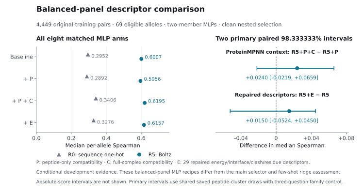

# ProteinMPNN context, few-shot HLA adaptation and repaired energy

13 October 2026. Few-shot fitting, saved-state replay and independent
numerical audit are complete; its primary adaptation gain is positive, including
under three-primary family control. ProteinMPNN extraction, all 900 head fits
and independent arithmetic/ancestry audits are complete. Its added context
increment beyond Boltz is inconclusive. Repaired FoldX extraction, all 300
new head fits and independent audits are complete; its increment beyond R5 is
also inconclusive. Few-shot adaptation is the only positive primary under the
original three-question family correction. One selected full-cohort ProteinMPNN
extension has been admitted; its assessment remains pending. The metadata/methods
result below is complete. This report does not change earlier completed findings.
[Shared protocol](PROTOCOL.md), [scientific review](SCIENCE_REVIEW.md) and
[execution record](EXECUTION.md).

## Three distinct development questions

ProteinMPNN asks whether native-peptide compatibility with the full complex
adds half-life ranking information beyond a learned Boltz representation and
compatibility on the peptide backbone alone. Few-shot adaptation asks whether
20 measured support peptides per new target allele improve predictions for
peptide families excluded from source fitting. The earlier label-budget study
instead removed source fitting labels; it did not adapt to a held-out allele.
A third, conditional question asks whether repaired FoldX interaction descriptors
add ranking information beyond R5. The [third-primary amendment](THIRD_PRIMARY_AMENDMENT.md)
records that decision at **12:35 UTC on 13 October**, before the manager
inspected new few-shot efficacy results and before ProteinMPNN assessment.

All three use only original-training outcomes. Prior results informed their choice,
so additional clean within-training holdouts remain conditional development
assessments. Ranking uses median per-allele Spearman on pooled held
predictions; each paired contrast subtracts the two panel medians, rather than
taking a median of allele differences or fold scores. The ≥20-row panel is
primary and ≥50-row panel a sensitivity. The original validation/test and
reserved external candidate outcomes do not enter these model assessments. Primary intervals remain individual 95% intervals. **98.333333% intervals**
for all three primaries support Bonferroni control of a tranche-wide success
claim, using the same frozen 2,000 draws and tails 1/120 and 119/120. Original
97.5% intervals remain visible as historically specified two-primary intervals,
superseded for tranche-wide claims. Exploratory secondary results do not replace any primary
or retrospectively pass the main study's separate +0.05 criterion.

## Primary methods and pinned artifacts

- **ProteinMPNN:** Dauparas et al. (2022), [*Robust deep learning–based protein
  sequence design using ProteinMPNN*](https://doi.org/10.1126/science.add2187),
  with the [official implementation](https://github.com/dauparas/ProteinMPNN).
  This study uses the full-backbone `vanilla_model_weights/v_48_020.pt`
  checkpoint, SHA256 `c9cb4a671d79…`, as pinned in the
  [inverse protocol](inverse_execution_v2/protocol.json). The pretrained
  checkpoint is distinct from inference settings: native-sequence scoring here
  adds zero coordinate noise and uses 16 explicit common peptide permutations.
- **FoldX:** Delgado et al. (2019), [FoldX 5.0](https://doi.org/10.1093/bioinformatics/btz184);
  Guerois et al. (2002), [the original empirical force field](https://doi.org/10.1016/S0022-2836(02)00442-4);
  and Schymkowitz et al. (2005), [the force-field and complex-analysis methods](https://doi.org/10.1093/nar/gki387).
  The [official suite](https://foldxsuite.crg.eu/about) documents the FoldX 5
  family. Our run identity is the pinned Linux executable `foldx_20261231`,
  SHA256 `faed5e54e477…`; a finer semantic release is not recorded. The
  [technical protocol](foldx/protocol.json) specifies `RepairPDB` with
  `repairInterface=ALL`, followed by native peptide–HLA `AnalyseComplex`,
  retaining β2m. E contains 29 numeric energy/interface/clash/residue descriptors.
- **Boltz-2:** Passaro et al. (2025), [*Towards Accurate and Efficient Binding
  Affinity Prediction*](https://doi.org/10.1101/2025.06.14.659707), a technical
  preprint, with the [official implementation](https://github.com/jwohlwend/boltz).
  Reused coordinates and interface features originate from the Boltz-2 model
  family. The [cache audit](../further_research/round2/resources/cache_completion_audit.json)
  pins the inference package to `boltz==2.1.1`, the weight-repository revision
  to `6fdef46d763fee7fbb83ca5501ccceff43b85607`, and checkpoint SHA256 to
  `090e82ac8c92…`. The software package version, model family and weight revision
  are separate identifiers; these follow-ups reuse the recorded artifacts.

These papers establish the upstream methods. Sequence compatibility and
computed binding free-energy descriptors do not directly measure dissociation
half-life; equilibrium binding free energy does not determine a dissociation
rate without kinetic information. Predictive value is the question tested by
our frozen supervised comparisons. The completed
[pre-results assessment source audit](ASSESSMENT_PRECHECK.md) found no blocking
defect before head fitting; it does not certify completed head outputs or
substitute for subsequent prediction, selection and ancestry audits.

## ProteinMPNN design and audit boundary

The frozen balanced panel has 4,449 original-training pairs, 75 alleles and
2,082 inherited peptide clusters, selected by identity with at most 64 rows per
allele. Five inherited cluster folds keep each retained family together.
Production coordinates are reused without a new folding cohort. Teacher-forced
native-peptide scores use checkpoint `v_48_020.pt`, zero coordinate noise and
16 explicitly shared peptide decoding permutations across contexts.

The P block contains nine position-wise mean native-residue log probabilities
on the same peptide backbone after removing other chains. C contains the
corresponding nine mean log probabilities with full HLA/β2m context. Each
position averages over the same 16 explicit decoding orders. Six arms are R0, R0+P, R0+P+C, R5, R5+P and R5+P+C. The
primary is the matched two-member MLP difference R5+P+C minus R5+P. All
regularization choices use clean inner predictions; 600 MLP members and
300 ridge sensitivity fits constitute the frozen fitting graph. All absolute
scores, the R5+P+C versus R5 comparison, corresponding R0 contrasts and the
representation-by-context interaction must remain visible.

P is not an unconditional sequence representation: its backbone came from a
complex predicted with the native sequence and HLA. Removing chains also changes
graph size and neighbors. A positive context increment therefore would not
identify structural causality, pose validity or kinetic mechanism. Conversely,
a null would not reject every inverse-folding representation or learner.

The first extraction attempt persisted no score rows and was stopped. The
[source-bound worker-start amendment](inverse_execution_v2/EXECUTION_AMENDMENT.md)
changes process startup and telemetry, preserving scientific specification,
coordinates, checkpoint, orders, panel and assessment. It discloses inherited
native-thread state as a plausible explanation, not an established cause.
Predictions, selections and split ancestry are audit targets. This reused head
does not save fitted states; no fitted-weight replay is claimed.

The original extraction stopped at its fixed deadline, **14:22 UTC**, with
**4,163 accepted extraction records, one failed record and 285 unwritten
identities**. The failure, HLA-B*56:01/YPAEITLTW, exposed a chain-selection
issue: the native nine-residue sequence also appears within the 275-residue
HLA chain. The first-substring selector found that HLA hit and the existing
length guard rejected it **before a ProteinMPNN forward pass**. A label-free
[inspection of the actual structure](inverse_parser_recovery/FAILED_STRUCTURE_INSPECTION.json)
confirms the unique whole nine-residue peptide chain C. The separately bound
[parser amendment](inverse_parser_recovery/SOURCE_BOUND_PARSER_AMENDMENT.md)
has passed review and parse-only preflight for both native-HLA motif cases.
It selects the unique entire matching chain, retains zero/multiple-match errors,
preserves all 4,163 accepted record hashes and
archives the original failure and scores only the 286 corrected/missing
identities. The completed continuation accepts all 4,449 frozen pairs and
preserves the 4,163 inherited records byte-identically, as checked by the
[head-admission audit](inverse_execution_v2/HEAD_ADMISSION_AUDIT.json) and
[parser-recovery receipt](inverse_execution_v2/parser_recovery_receipt.json). Original source/protocol bytes remain preserved, including
active energy bindings. FoldX uses a different parser and is unaffected by
this defect. The 4,449-pair panel, coordinates, decoding orders and planned
comparisons are unchanged. The completed independent assessment audit binds
this recovery ancestry; no missing-case or complete-case panel was substituted.

## Completed ProteinMPNN result

The primary matched MLP context increment, **R5+P+C minus R5+P**, is
**+0.023960 [−0.014736,0.058359]** under the individual 95% interval. Its
required **98.333333% three-primary family interval is
[−0.021942,0.065942]**, derived by the independent audit from the same saved
2,000 peptide-cluster draws. The historical two-primary 97.5% fields in the
original comparison CSV give [−0.020409,0.064692]; those fields are retained
historically and superseded for tranche-wide claims.

The important net increment **R5+P+C minus R5** is **+0.018816
[−0.016250,0.056637]** under its exploratory nominal 95% interval. R5 scores
0.600708, P-only augmentation 0.595564, and full P+C augmentation 0.619524.
Thus neither the primary context increment nor the net increment establishes
an additional benefit beyond the matched Boltz head. A useful small increment
remains possible; this is not equivalence or a rejection of all inverse-folding
representations. The balanced panel and two-member head differ from the main
full-cohort competitive selector and the few-shot source ridge assessment.

| Arm | MLP, ≥20 (69 alleles) | Ridge, ≥20 | MLP, ≥50 (68 alleles) | Ridge, ≥50 |
|---|---:|---:|---:|---:|
| R0 | 0.295240 | 0.149447 | 0.292158 | 0.148067 |
| R0 + P | 0.289204 | 0.135086 | 0.288284 | 0.130626 |
| R0 + P + C | 0.340620 | 0.293213 | 0.339086 | 0.289282 |
| R5 | 0.600708 | 0.626800 | 0.597830 | 0.625071 |
| R5 + P | 0.595564 | 0.630401 | 0.593336 | 0.629116 |
| R5 + P + C | 0.619524 | 0.623753 | 0.619344 | 0.623035 |

P and C are the nine-position native-peptide compatibility blocks defined
above; P's backbone was itself predicted with native peptide/HLA context.
All six arms are shown for both learners and both eligible panels. The ≥20
panel has 69 alleles and 4,380 assessment rows; the ≥50 panel has 68 alleles
and 4,352 rows. All outer-held predictions retain the full 4,449-pair panel;
metric eligibility is distinct from extraction failure.

The ≥50 MLP context increment is +0.026008 [−0.014884,0.057774], again
inconclusive. R5 ridge context is −0.006648 [−0.015061,0.017530] and net
P+C augmentation is −0.003047 [−0.015937,0.018075]. R0 controls have positive
exploratory nominal intervals: MLP context +0.051416 [0.012736,0.123276],
MLP net +0.045380 [0.005375,0.112917], ridge context +0.158127
[0.080704,0.192908] and ridge net +0.143766 [0.071995,0.184282]. P-only
increments are inconclusive on both representations/learners. The MLP
representation-by-context interaction spans zero; the ridge interaction is
negative under its nominal interval. These secondary/sensitivity findings
do not replace the declared R5 MLP primary, identify structural causality,
or establish independent half-life confirmation. All **28 declared comparison
rows** remain in [the saved CSV](inverse_execution_v2/comparisons.csv), with
all **24 absolute score rows** in [pooled scores](inverse_execution_v2/pooled_scores.csv).

The [cloud completion audit](inverse_execution_v2/completion_audit.json) and
[independent assessment audit](inverse_execution_v2/independent_audit.json)
verify 600 MLP members, 300 ridge fits, complete panel coverage, gradient/
stopping/scaler ancestry, inner score/selection arithmetic, all declared
contrasts and saved-draw interval arithmetic, including parser-recovery lineage.
The [primary family artifact](inverse_execution_v2/primary_family3_interval.json)
contains the current family interval. The [reproducible independent audit](../../scripts/followup3_representation_independent_audit.py)
does not refit heads, regenerate bootstrap draws or replay fitted weights;
these heads do not persist their fitted states. This remains conditional
development evidence.

A **post-hoc descriptive influence diagnostic** keeps eligibility fixed from
the original 69-allele panel, without refitting or reselecting after deletion.
The MLP net R5+P+C minus R5 point remains positive after removing any single
scored allele (+0.016474 to +0.028273) or any one outer-held prediction fold
(+0.011860 to +0.040450). Every retained fixed-panel fold deletion remains
rankable. This does not imply uniformly positive allele effects: 43 individual
allele correlations rise and 26 fall. Ridge still disagrees: its full net
point is −0.003047, all single-allele deletion points stay negative, and fold-
deletion points span −0.014196 to +0.006828. These checks have **no new confidence
interval or inference upgrade**, do not change the primary family, and leave
the original MLP uncertainty inconclusive. [Source summary](inverse_execution_v2/exploratory_influence/summary.json),
[all allele deletions](inverse_execution_v2/exploratory_influence/leave_one_allele.csv),
[all fold deletions](inverse_execution_v2/exploratory_influence/leave_one_outer_fold.csv).

## Completed few-shot result

With 20 target measurements per allele, R5 improves from **0.529583** at
zero labels to **0.576337**: **+0.046754 [0.022657, 0.103467]**, using the
individual crossed 95% interval. The **98.333333% three-primary family interval
is [0.014042, 0.119457]**, supporting a positive conditional adaptation gain.
The original two-primary 97.5% interval is [0.016161, 0.113802], preserved
historically and superseded for tranche-wide claims. These differences cannot
be directly compared with the main study's +0.0543: source exclusions, query
population, learners and available target labels differ.

**Figure 1.** Strict joint transfer with target HLA groups and support/query
peptide families excluded from source fitting. Curves show the mean of three
fixed support-draw scores on 68 alleles; the sequence comparator is a reduced
historical four-member anchor. The primary R5 gain uses the crossed
98.333333% three-primary family interval; individual curve intervals are not
shown. This is conditional development evidence, without prospective assay-
savings or independent-confirmation claims. [PNG export](figures/fewshot_curves.png),
[exact plotted values and source hashes](figures/fewshot_curves.json),
[reproducible renderer](figures/build_fewshot.py).

| Labels per target allele | Summed target labels per draw | R0 ridge | R5 ridge | Four-member sequence anchor |
|---|---:|---:|---:|---:|
| 0 | 0 | 0.053755 | 0.529583 | 0.082976 |
| 5 | 340 | 0.079463 | 0.539286 | 0.144005 |
| 10 | 680 | 0.104730 | 0.559218 | 0.166569 |
| 20 | 1,360 | 0.142517 | 0.576337 | 0.205753 |

The table averages three draw-specific scores on the fixed 68-allele panel.
All 72 draw/panel/arm/budget score rows remain in
[scores by draw](fewshot/scores_by_draw.csv), with all 24 mean curve rows in
[absolute curves](fewshot/absolute_curves.csv). R5's draw-specific k=20 gains
are +0.041171, +0.032843 and +0.066248. Query rows number 14,625, 14,775 and
14,799 respectively and are held fixed across budgets within each draw.
Duplicates across support draws are not pooled as independent observations.

The peptide-only primary interval is [0.036176, 0.074385], and HLA-only is
[0.025663, 0.104149]. The ≥20 and ≥50 panels are **the identical 68 alleles**,
so their equality supplies no additional population robustness. Every one of
the 35 actual-HLA-group deletions retains a positive primary point difference,
ranging from +0.033232 to +0.068527; these checks do not refit models.

The secondary R0 k=20 gain is +0.088762 [0.046165, 0.120936] and the
sequence-anchor gain is +0.122777 [0.071624, 0.159940] under crossed nominal
95% intervals. R5 starts substantially stronger and remains stronger in
absolute score. Its adaptation-gain interaction versus R0 is −0.042008
[−0.074497, 0.024903], so the crossed assessment establishes no interaction.
The k=5 R5 gain is inconclusive; k=10 is positive under its nominal interval.
All 108 frozen comparisons, three uncertainty modes and both panel labels
remain in [comparisons](fewshot/comparisons.csv); these secondaries are exploratory.

Source label availability ranges from 11,213 to 11,950 per cell. The actual
sequence MLP gradient/stopping union ranges from 10,213 to 11,055, because
joint stopping removes cross-quadrants; ridge uses the full available source
pool. All source stopping labels count. At k=20 each draw uses exactly
1,360 target labels, with zero target tuning/stopping labels and reuse across
five query cells counted once. [Actual target budgets](fewshot/actual_budgets.csv),
[source budgets](fewshot/source_budgets.csv) and fixed support/query inventories
retain the detailed accounting.

The cloud [completion audit](fewshot/audit.json) records exact saved-state
prediction replay for all 450 source fits and 9,180 adapters across 75 cells.
The separate [independent numerical audit](fewshot/independent_audit.json)
checks 825 payload hashes, all 72 score rows, 108 comparison rows, 1,260 group-
deletion rows, source predictions, adapter residual offsets and split ancestry.
It verified the cloud replay assertions without independent refitting, full
matrix replay or bootstrap regeneration. The [family interval artifact](fewshot/primary_family3_interval.json)
is derived from the original saved draws and binds the pre-efficacy amendment.
The [audit script](../../scripts/followup3_fewshot_independent_audit.py) reproduces
these lightweight checks. None of these findings establishes prospective assay
savings, structural causality or independent assay confirmation.

A **post-hoc offset-control diagnostic**, chosen after the positive primary
result, separates feature-dependent residual correction from alignment between
source/query cells. Using saved fits and the same labels, R5 scores are 0.529583
zero-shot, 0.531987 with each cell/allele's fitted scalar offset alone, and
0.576337 with the full adapter. Full minus offset is **+0.044350
[0.016478,0.092778]**; offset minus zero is **+0.002404
[−0.006172,0.023880]**, with nominal unadjusted 95% intervals. The feature term
adds ranking beyond this offset control on saved predictions; an offset-only
benefit remains unresolved. Scalar shifts preserve all within-cell ranks but
can change pooled ranks across cells. The independent audit checks 44,199
query predictions, 1,020 offset/rank checks and paired-bootstrap arithmetic;
the two components sum to the original gain at the point and every paired
draw. No new fits or labels are used. This is exploratory, not a fourth primary,
and leaves the three-primary family unchanged. [Diagnostic report](fewshot_offset/REPORT.md),
[independent audit](fewshot_offset/independent_audit.json),
[reproducible check](../../scripts/followup3_offset_independent_audit.py).

## Few-shot design and audit boundary

Three fixed support draws and all 25 joint HLA-fold × peptide-fold cells use
68 eligible target alleles. Support budgets are nested prefixes of 0, 5, 10 and
20 distinct peptide clusters per allele. Within each held-out HLA fold, the
union of maximum-support families across that fold's target alleles is excluded
from its source/query cells, including at k=0. Source fitting additionally
excludes both held grouping axes. Queries
are identical across arms and budgets within a draw, with the allele panel fixed
from the eligibility intersection across all three query sets.

R0 and R5 source ridge heads use alpha 100; per-allele residual ridge adapters
use alpha 1 and source-scaled features divided by the square root of dimension.
The sequence anchor uses the historically nominated two-layer recipe, with
two source stopping/seed members per one-hot/BLOSUM encoding. Its four-member
ensemble is a bounded historical anchor, not the unchanged full main competitive
selector. Target tuning and stopping use zero labels. The graph has 450 source
fits and 9,180 tiny adapter solves, counted separately.

The primary is the mean of three draw-specific R5 k=20 minus k=0 score
contrasts. Scores, rather than predictions, are averaged. Each draw uses 0,
340, 680 or 1,360 support labels summed across its 68 target alleles; support
labels are reused across five query cells and counted once per draw/budget.
Source stopping labels count too; available source labels and the actual
MLP gradient/stopping union must both be reported. Fixed-query absolute curves
for every arm/budget prevent a difference-in-gains from obscuring zero-shot
performance. Matched R0/sequence gains and representation/adaptation interaction
remain secondary.

Two thousand shared resamples with seed 20261003 are used in each study.
ProteinMPNN resamples whole inherited peptide clusters. Crossed
peptide/HLA-group resampling supplies the few-shot primary interval. Peptide-only,
HLA-only, ≥50-panel and every actual-HLA-group deletion are sensitivities.
Group deletion changes the score panel without retraining. These checks
condition on fixed source fits, adapters and three support designs,
excluding new assay/acquisition variation. The experiment does not estimate
prospective assay savings or encoder fine-tuning.

The first cloud pilot failed saved-scaler replay after one R0 ridge fit. The
[operational scaler amendment](fewshot/SCALER_REPLAY_AMENDMENT.md) restores the
fitted scikit-learn transform instead of a handwritten arithmetic order that
rounded float32 differently. Fitted preprocessing and the scientific design
are unchanged; exact replay assertions remain, with no tolerance widening.
Failed artifacts and the original protocol are preserved separately.

## Independent confirmation is still gated

The completed [metadata/methods audit](independent_data/PROVENANCE.md) reproduces
129 candidates, 126 peptides, 113 standard-9mer components, nine alleles and
36 cited publications under the conservative exclusion policy. It preserves
all rows and the external candidate outcome-column reservation. Bibliographic resolution is
not measurement-level lineage verification.

Primary methods establish heterogeneous endpoints, temperatures and constructs,
including a definite release-assay category mismatch. Cellular surface
persistence, purified-complex dissociation and thermal melting cannot be pooled
as one endpoint. WT/mutant constructs, probe tags, drug/chaperone conditions,
measurement IDs, time courses, replicate definitions and censor flags remain
unresolved for relevant rows.

The largest single-study/allele stratum is Strønen 2016, HLA-A*02:01, with
23 rows. Original methods/supplement access and measurement mapping remain
unverified. A narrow frozen-model assessment could become defensible after those
gates and checkpoint ancestry are resolved, but it would remain one study/one
allele without a ≥50-row sensitivity, leaving representative confirmation open.
No candidate outcome was joined, scored, used for selection or summarized.
Incidental visibility of public-paper result sections during retrieval is
disclosed, so the literature audit is not described as fully blinded.

## Repaired FoldX: technical completion and conditional development study

All 32 predetermined original-training technical cases completed paired raw
and repaired interaction extraction with finite terms and native identity/
coordinate checks; no rows failed. The [technical receipt](foldx/technical_receipt.json)
records 999.0 seconds of elapsed worker time and 6,205.3 summed case-seconds.
These are extraction measurements, with no half-life assessment. Repair-induced
energy changes do not establish kinetic ranking or an energy-performance ceiling.

The conditional production study uses the same frozen 4,449-pair panel and
inherited cluster folds as ProteinMPNN. E contains 29 frozen numeric energy
and interface/clash/residue descriptors, with resource settings frozen from
technical data and verified pilot rows reused. Production extraction used
the [reviewed execution amendment](energy_execution_v2/EXECUTION_AMENDMENT.md).
The first application stopped before any new scoring because a mounted-volume
reload encountered open native-library files. Its [failed-attempt receipt](resources/energy_extract/failure.json)
is preserved; the new namespace repairs runtime handling without changing the
scientific scope. This application subsequently stopped with **4,376 accepted
records and 73 interrupted attempts** following explicit worker preemptions.
A separately source-bound manual recovery completed those 73 identities with
the unchanged recipe. The [independent recovery audit](energy_recovery_v3/independent_recovery_audit.json)
verifies all 4,376 original success hashes and 73 interrupted-attempt records
remain unchanged. The [feature-matrix audit](energy_recovery_v3/independent_feature_audit.json)
verifies the complete 4,449 × 29 matrix exactly. Full panel coverage preceded
supervised assessment; no complete-case fallback was used. [Execution record](EXECUTION.md).
Missing/failed production rows stop assessment;
they cannot silently change the panel. R0/R5 baselines can be reused only after
exact recipe and identity validation. Only R0+E and R5+E add fits: 200 MLP
members and 100 ridge sensitivity fits. The primary is MLP R5+E minus R5;
the R0 increment and representation interaction remain secondary. There is no
combined ProteinMPNN/energy arm or expanded grid. The technical pilot supplies
no prediction-efficacy claim; supervised results follow below.

## Completed repaired-descriptor result

The primary MLP **R5+E minus R5** is **+0.014991 [−0.043512,0.036368]**
under its individual 95% interval. The required **98.333333% three-primary
family interval is [−0.052436,0.045026]**. Absolute scores rise from 0.600708
to 0.615698, but this does not establish an additional benefit beyond the
matched Boltz head. Neither this result nor the ProteinMPNN comparison is an
equivalence test. Few-shot adaptation is the sole positive primary in the
original three-question family.

| Arm | MLP, ≥20 (69 alleles) | Ridge, ≥20 | MLP, ≥50 (68 alleles) | Ridge, ≥50 |
|---|---:|---:|---:|---:|
| R0 | 0.295240 | 0.149447 | 0.292158 | 0.148067 |
| R0 + E | 0.327591 | 0.282594 | 0.321804 | 0.282369 |
| R5 | 0.600708 | 0.626800 | 0.597830 | 0.625071 |
| R5 + E | 0.615698 | 0.633310 | 0.615078 | 0.632506 |

R5 ridge adds **+0.006510 [−0.023760,0.020296]**, and the ≥50-panel MLP and
ridge increments are +0.017248 [−0.043292,0.034193] and +0.007435
[−0.022135,0.019077]. These nominal 95% sensitivities remain inconclusive.
The weak R0 ridge gains +0.133147 [0.063701,0.175052] on the primary panel;
this exploratory benefit does not establish additional value over the incumbent
R5 representation. R0 MLP gain +0.032352 [−0.018518,0.100889] is unresolved.
The representation interaction is inconclusive for MLP and negative for ridge
under nominal intervals. All **16 absolute score rows** and **12 declared
contrasts**, including both panels and learners, remain in
[pooled scores](energy_execution_v2/pooled_scores.csv) and
[comparisons](energy_execution_v2/comparisons.csv). Secondary intervals are
unadjusted and do not replace the primary.

The [cloud completion audit](energy_execution_v2/completion_audit.json),
[independent assessment audit](energy_execution_v2/independent_audit.json) and
[final independent review](energy_execution_v2/INDEPENDENT_FINAL_REVIEW.json)
verify 200 new MLP members, 100 new ridge fits, exact reuse of R0/R5 baselines
with zero baseline refits, complete panel coverage and prediction/selection/
ancestry arithmetic. The [current family artifact](energy_execution_v2/primary_family3_interval.json)
is bound to the same saved peptide-cluster draws. Independent checking did not
refit heads or regenerate bootstrap draws. Fitted states are not saved and
fitted-weight replay is not claimed. These remain conditional development
results; repaired equilibrium energy and interface descriptors are not direct
measurements of kinetic half-life.

**Figure 2.** All eight MLP arms on the same 4,449-pair original-training panel,
with the two descriptor primaries and their 98.333333% family intervals. P is
peptide-only compatibility, C full-complex compatibility, and E the 29 repaired
energy/interface/clash/residue descriptors. Absolute-score intervals are not
shown. These matched two-member MLP recipes differ from the main full-cohort
competitive selector and strict joint few-shot source ridge. The figure does
not pool or directly compare those assessments. [PNG export](figures/descriptor_comparison.png)
and [exact plotted rows and source hashes](figures/descriptor_comparison.json).

## Selected full-cohort development extension

After both descriptor studies and their independent audits, the
[frozen decision](FULL_COHORT_DECISION.json) admits **one final ProteinMPNN
extension over all 19,716 original-training pairs**, under the
[pre-results framework](FULL_COHORT_DECISION_FRAMEWORK.md). It reuses 4,449
accepted native scores and extracts 15,267 additional rows. Three frozen arms,
R5, R5+P and R5+P+C, require 300 MLP members and 150 ridge fits; the main
comparison is MLP R5+P+C minus R5, with ridge and ≥50-panel sensitivities.
All 19,716 rows are required before assessment. A descriptive comparison of
old and new predictions on the same original 4,449 query rows examines changes
in source coverage, inner selection and stopping. It introduces no additional
fit or confidence interval and does not isolate a causal sample-size effect.

The [label-free cohort comparison](inverse_fulltrain_metadata/cohort_metadata_comparison.json)
shows the same **75 alleles**, with rows increasing **4,449 → 19,716 (4.43×)**
and inherited peptide clusters **2,082 → 3,587 (1.72×)**, including 1,505 new
clusters. Of the 15,267 additional rows, 11,656 belong to previously covered
clusters and 3,611 to new clusters. This quantifies both coverage and density;
4.43× rows does not imply 4.43× independent evidence, and cluster counts are
not effective sample size. The ≥20/≥50 counts in this label-free artifact are
row-count thresholds only, without assay-rankability eligibility. No labels,
predictions or ProteinMPNN scores entered this metadata comparison.

The choice uses the small positive balanced-panel MLP net point and descriptive
influence checks, despite inconclusive intervals and ridge disagreement. This
is a selected development transport check, **not independent confirmation or
a fourth primary in the original family**. Assessment is pending. No full FoldX
expansion, combined descriptor arm, extra grid or follow-on search is admitted.
The four disjoint extraction batches each have a $8.50 cap; extraction plus
staging/fitting/reporting is bounded by **$40**, within the authorized $139
tranche ceiling. Original validation/test and reserved external outcomes remain
excluded; the independent-assay requirement remains open.

All heavy extraction, fitting and statistical resampling run on Modal. The new
tranche has a separately authorized $139 inclusive ceiling with smaller bounded
admissions; credits are a limit, not a spending target. Historical phase costs
are separate. The [root-owned ledger](budget.json) and execution record retain
failed attempts, reservations, conservative charges and resource-closure status.
Runtime-derived accounting is not a reconciled invoice or live credit balance.
